<div align="center">

<picture>
  <source media="(prefers-color-scheme: dark)" srcset="docs/media/brand/potionui-mark-light-256.png">
  
</picture>

# PotionUI

**The self-hosted generation studio you can hand to other people.**

Images, video and music on your own GPU · Free and open source · Linux & Windows

[](https://github.com/PotionUI/PotionUI/releases)
[](https://github.com/PotionUI/PotionUI/actions/workflows/backend-tests.yml)
[](LICENSE)
[](https://github.com/PotionUI/PotionUI/stargazers)
[](#install)

[](https://discord.gg/avR4trp3b8)
[](https://www.reddit.com/r/PotionUI/)
[](https://ko-fi.com/A3B325D031)

**[Install](#install)** · [Quick start](#60-seconds-to-first-image) · [Website](https://potionui.com) · [Docs](https://potionui.com/docs) · [Changelog](#changelog) · [Contributing](CONTRIBUTING.md) · [Security](SECURITY.md)

Run Krea-2, Anima, SDXL, Flux, Wan, LTX, Qwen-Image, MiniMax and YuE2 on one box — then give your team, your household, or your agents their own logins, presets, and limits. No node graphs. No per-model setup. Pick a model, type, watch it render live.

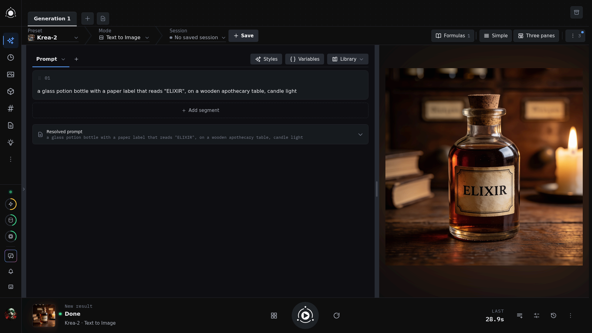

<details>
<summary>Watch the 60-second tour (video)</summary>

https://github.com/user-attachments/assets/950415f7-da97-403e-811b-4c9c41d8106f

</details>

</div>

**Why PotionUI:**

- **Forms, not wiring** — each model exposes only the controls it actually
  understands.
- **Accounts, groups, admin panel** — one GPU, many users, per-user presets
  and model access.
- **Drive it from Claude Desktop or any MCP client** — per-user tokens; every
  write action needs your approval.
- **Video Director** — compose shots in sections instead of one giant prompt.

*Beta 0.1.0 · Linux x86_64 + NVIDIA · Windows native (experimental), WSL2 or
Docker ·
[Discord](https://discord.gg/avR4trp3b8) · [Reddit](https://www.reddit.com/r/PotionUI/) ·
[Ko-fi](https://ko-fi.com/A3B325D031)*

## 60 seconds to first image

```bash
git clone https://github.com/PotionUI/PotionUI.git potionui && cd potionui
./potionui doctor    # check prerequisites, with a repair command for anything missing
./potionui start     # create the venv, install deps, launch backend + frontend, print the URL
```

Native Windows (experimental): `.\potionui.cmd doctor` and `.\potionui.cmd start`
from PowerShell or cmd — see [Windows (native)](#windows-native).

Floor: 8 GB VRAM + 16 GB RAM (SDXL). Full requirements below.

## Contents

- [What you're looking at](#what-youre-looking-at)
- [Modes](#modes)
- [Multi-user, with an admin panel](#multi-user-with-an-admin-panel)
- [AI assistant](#ai-assistant)
- [The generate workspace](#the-generate-workspace)
- [History, tags, and collections](#history-tags-and-collections)
- [Video Director](#video-director)
- [Prompt tooling](#prompt-tooling)
- [Automations](#automations)
- [Plugins](#plugins)
- [Install](#install) — [supported platforms](#supported-platforms),
  [manual setup](#running-backend-and-frontend-separately)
- [Documentation](#documentation) · [Changelog](#changelog)
- [Contributing](#contributing) · [Support](#support) · [License](#license)

## What you're looking at

- **Pick a model, get the right controls** — each model ships a form with only
  the controls it understands: resolution, camera angle, art style, whatever
  applies.
- **Watch it happen live** — step-by-step progress, streaming previews, and a
  gallery that fills in as results land.
- **One app for all of it** — images, video, and audio side by side, no
  per-model setup.

| Model family       | What it does                              | Docs                                                           |
| ------------------ | ----------------------------------------- | -------------------------------------------------------------- |
| SDXL               | Image (txt2img, inpaint)                  | [docs/models/sdxl.md](docs/models/sdxl.md)                     |
| Flux (1 / 2 Klein) | Image (txt2img, img2img)                  | [docs/models/flux.md](docs/models/flux.md)                     |
| Qwen-Image         | Image (txt2img, img2img, edit, restyle)   | [docs/models/qwen_image.md](docs/models/qwen_image.md)         |
| Krea-2             | Image (txt2img, enhance)                  | [docs/models/krea2.md](docs/models/krea2.md)                   |
| Z-Image            | Image (txt2img)                           | [docs/models/z_image.md](docs/models/z_image.md)               |
| Anima              | Image (txt2img)                           | [docs/models/anima.md](docs/models/anima.md)                   |
| Wan 2.1 / 2.2      | Video                                     | [docs/models/wan.md](docs/models/wan.md)                       |
| LTX-2 / 2.3 / 2.5  | Video (with audio), video edit, upscale   | [docs/models/ltx.md](docs/models/ltx.md)                       |
| MiniMax-H3         | Video (with reference images), video edit | [docs/models/minimax_h3.md](docs/models/minimax_h3.md)         |
| MiniMax-Music3     | Audio (song)                              | [docs/models/minimax_music3.md](docs/models/minimax_music3.md) |
| YuE2               | Audio (song, lyrics + style tags)         | [docs/models/yue2.md](docs/models/yue2.md)                     |
| SeedVR2            | Image & video upscale / restore           | [docs/models/seedvr2.md](docs/models/seedvr2.md)               |

## Modes

A model does more than one job. The mode picker beside the preset switches
it, and the form changes to what that mode needs.

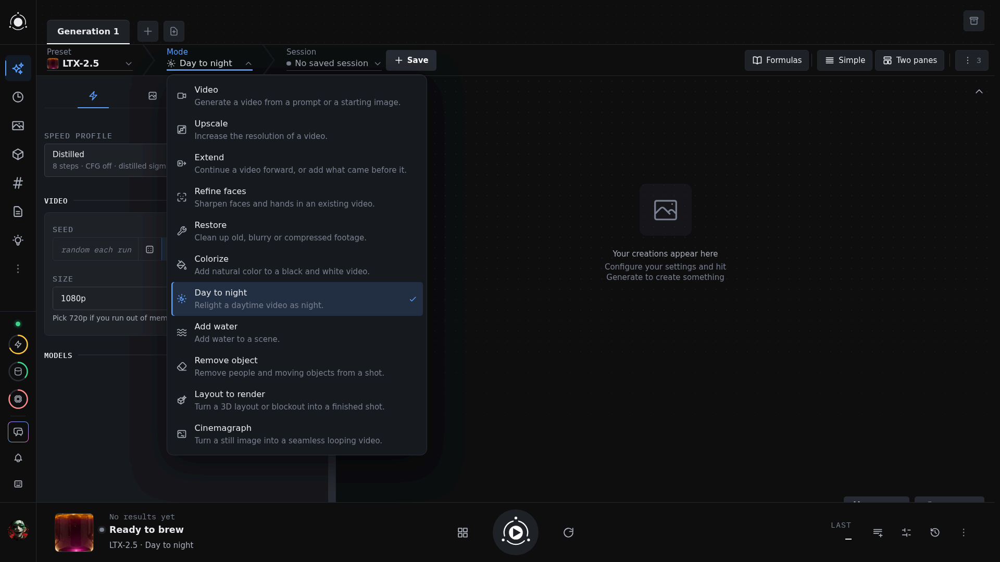

- **LTX-2.5** — beside Video and Upscale: Restore old or compressed footage,
  Colorize black-and-white video, relight it from Day to night, Add water,
  Remove object (people and moving things), Layout to render (a 3D blockout
  into a finished shot), Cinemagraph (a still into a seamless loop), Extend a
  clip forward or add what came before it, and Refine faces. Edit modes keep
  the source's audio and length.
- **MiniMax-H3** — beside Video and References to Video: Extend continues a
  video or adds a lead-in, Refine faces sharpens faces and hands, Remix
  re-creates a video with a change, Talking video makes a portrait speak a
  voice clip, and Upscale raises a clip's resolution with an optional Scene
  prompt.
- **Qwen-Image 2.1** — beside Text to Image, Edit image, and Structure: Edit
  text replaces or adds text in a picture, optionally only inside a painted
  box; Restyle changes the style, background, or lighting, or colorizes and
  restores a photo; Combine images edits one picture using up to nine others,
  each picked with **@** in the prompt.

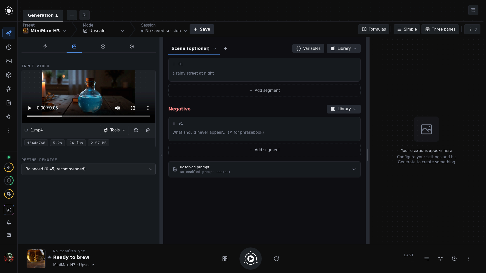

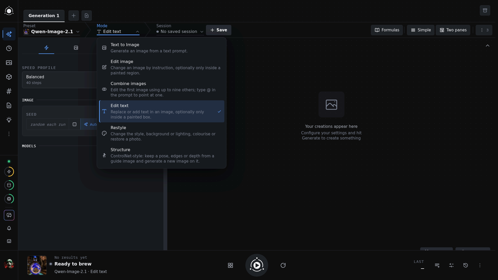

## Multi-user, with an admin panel

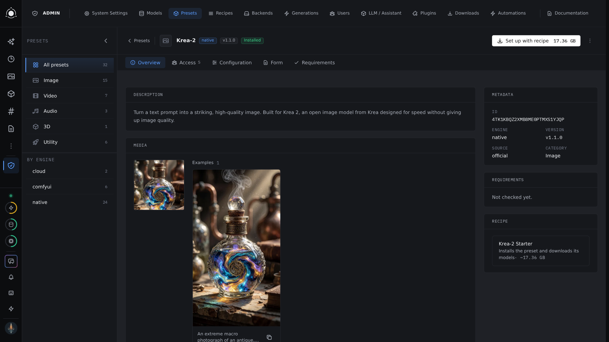

PotionUI is built for more than one person on the same box:

- **Users and groups** — create accounts, group them, and assign presets,
  models, and LLM configurations per user or to a whole group at once.
- **Presets under control** — decide who sees which preset, and reshape any
  preset's form per mode: change defaults, lock fields, or hide them
  entirely, no YAML editing required.
- **Backends** — configure where generations run and let users pick between
  enabled backends.
- **LLM setup** — wire up the providers behind the assistant (Ollama,
  OpenRouter, …) and hand them out per user or group.
- **Models, plugins, settings** — manage installed models and downloads,
  toggle plugins, and set global options, all from the same panel.

The full tour: [docs/user/admin.md](docs/user/admin.md).

## AI assistant

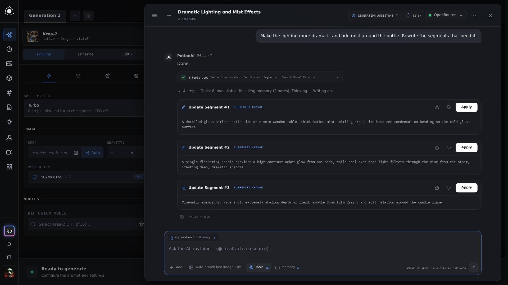

- Configure a language model and get an assistant beside generation: it
  brainstorms and rewrites prompts, edits phrasebook values, adjusts form
  state — **with your approval on every action that changes something**.
- The same tools are reachable from outside the app: PotionUI mints per-user
  [Model Context Protocol](https://modelcontextprotocol.io) tokens, so an MCP
  client (Claude Desktop, an agent, your own tooling) can drive your instance
  directly.

## The generate workspace

<!--
SCREENSHOT SLOT — GENERATE / VIDEO PRESET
A video preset selected (Wan or LTX), curated form visible (resolution,
frames, sampler), generation in progress with the live streaming preview
and a step progress bar mid-run.
-->

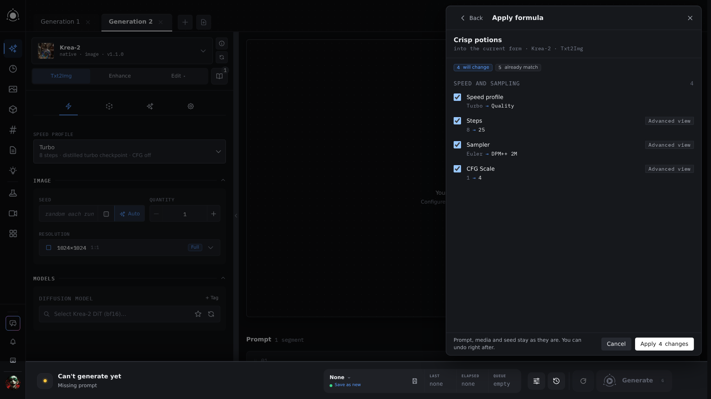

- Every tab is its own sandbox — preset, mode, prompts, and results — so you
  can run several ideas side by side without losing any of them.
- Switch models and the form swaps to match; the same tab handles txt2img,
  img2img, inpainting, or a video/audio mode.
- Like a setup? Save it as a **session** — preset, mode, prompts, and form
  values — and pull it back up any time.
- Save the settings that worked as a **formula** and apply them in any
  session, with a preview of exactly what changes.
- One media field holds reference images, videos, and audio in their own
  groups; type **@** in the prompt to use any of them.

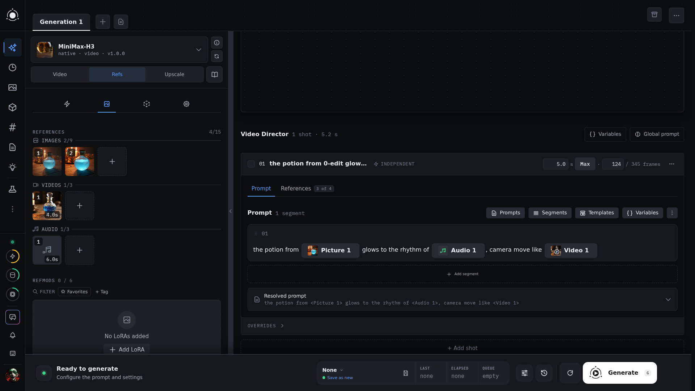

## History, tags, and collections

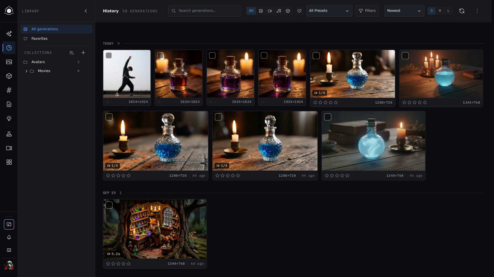

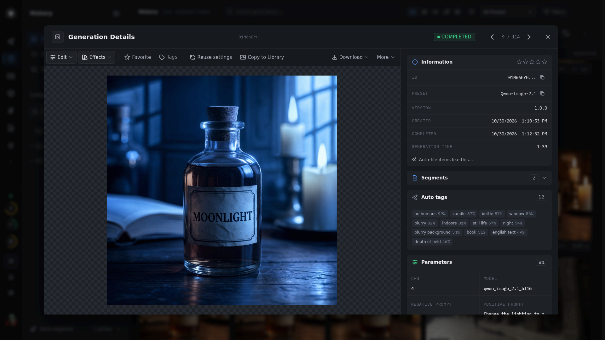

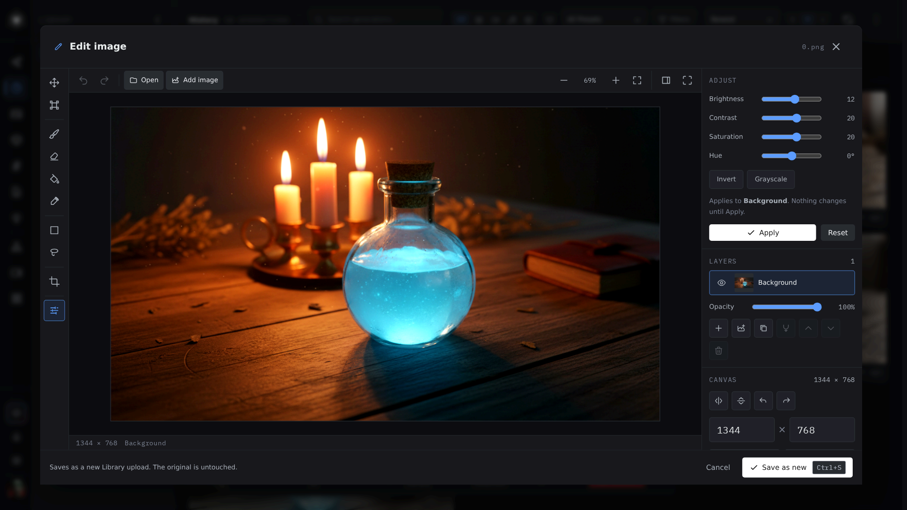

https://github.com/user-attachments/assets/f46cde26-0288-4e05-ac90-c3be31f0d2dd

- Everything you generate is saved automatically, with the exact parameters
  that produced it.
- Tag generations to group and re-find them; bulk-delete by tag to clear out
  throwaway experiments.
- Sort work into collections, and compare two results side by side.
- Fix a picture without leaving the app: Edit → Edit image adjusts, crops,
  paints, and layers it, then saves a new copy. The same editor opens from
  any media field in a preset form.

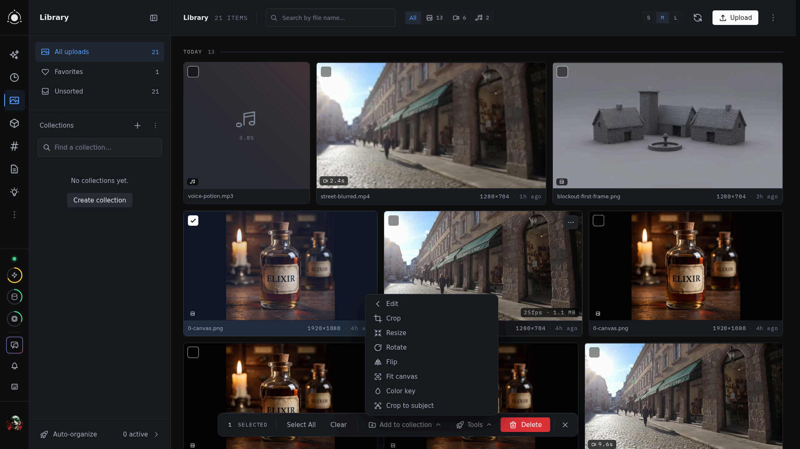

**Media tools** — one catalog of tools works on Library and History items,
from the Tools menu, a card's menu, or the details action bar: Edit holds
trim, crop, resize, rotate, flip, speed, fit canvas, color key, crop to
subject, frame grab, split, and concat, and Effects applies photo-filter
looks. A run goes to the background with progress and Cancel on its card. On
a Library item each tool's dialog offers Save as new or Replace original; an
edit started from History saves a copy to the Library and leaves the
generation as it was. PotionAI, automations, and presets can run the same
tools, and plugins can add their own.

## Video Director

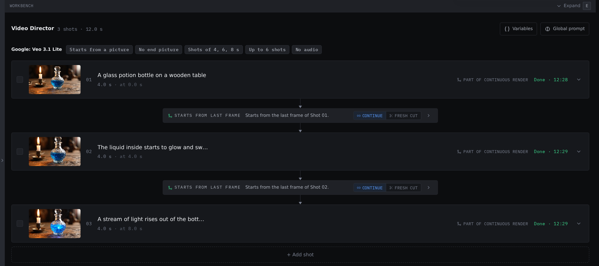

- Build a shot out of **global, timed, and chained sections** instead of
  hand-managing separate prompt fields per segment.
- Same segment-card editor as everywhere else in PotionUI, aimed at a
  timeline.

## Prompt tooling

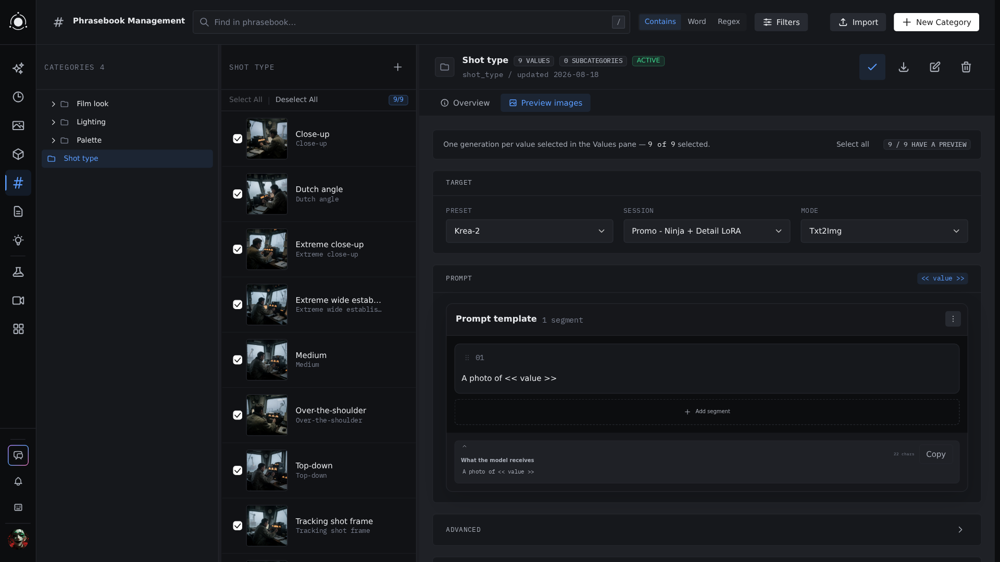

- **Segments** — save a prompt fragment once, drop it into any prompt; group
  related segments into templates.
- **Phrasebook** — autocomplete for known terms (art styles, camera angles,
  lighting) with per-chip shuffle for quick variation.
- **Dynamic prompts** — `{a|b}`, weighted choices, `${vars}`.
- **LLM enhancement** — optional, layered on the same editor.

## Automations

- Wire **triggers** (schedule, manual, file watcher, GPU VRAM threshold, app
  events) through **conditions** to **actions** (tag, add to a collection,
  assign models or users, backend actions, notifications, indexing) on a
  visual graph.
- Start from an importable template, export as JSON, and read every run's
  history and logs in the same editor.

## Plugins

Nearly every subsystem is an extension point — even alternate inference
backends are plugins, not core code:

- **Providers** — credentialed connections to model marketplaces (e.g. CivitAI)
- **Backends** — configured instances of an inference engine (e.g. a ComfyUI
  server via the `comfyui-backend` plugin, which also ships image presets for
  SDXL, Qwen-Image, Z-Image, Krea-2, and Flux Klein 9B); you can import your
  own ComfyUI workflows as presets too — see
  [docs/presets/comfyui.md](docs/presets/comfyui.md); hosted cloud models
  come from the `openrouter-provider`, `bfl-provider`,
  `google-gemini-provider` and `openai-provider` plugins, each with its own
  presets — see [docs/cloud-models.md](docs/cloud-models.md)
- **Pipes** — the individual steps a generation pipeline is built from
- **Field types, chat modes, frontend pages** — all pluggable

Plugin code imports only from `src/plugin_api/`. Authoring reference:
[docs/plugin-api.md](docs/plugin-api.md).

## Install

> [!WARNING]
> PotionUI is in **beta**: expect rough edges and breaking changes between
> releases. Back up anything you care about, and report what breaks — issues
> and Discord reports steer what gets fixed next.

> [!IMPORTANT]
> **Linux x86_64 with an NVIDIA GPU** is the tested 0.1.0 matrix. **Native
> Windows is supported experimentally** as of 0.0.8: the installer, the CLI,
> the backend test suite, the frontend checks and the E2E harness all run in
> CI on `windows-latest` — see [Windows (native)](#windows-native) below.
> WSL2 and Docker Desktop work too. Details in
> [Supported platforms](#supported-platforms).

PotionUI can generate on this machine's GPU, dispatch to a remote worker, or
both — the `./potionui` CLI has an install preset for each.

**Pick an install:**

| You have                                              | What gets installed                                                 | Command                             |
| ------------------------------------------------------ | ----------------------------------------------------------------- | -------------------------------------- |
| A GPU in this machine                                 | Full CUDA stack                                                    | `./potionui start`                     |
| A GPU here, plus room to add remote workers later      | Full CUDA stack                                                    | `./potionui start --profile hybrid`    |
| No GPU here (a VPS or laptop) — dispatch to a worker    | CPU-only PyTorch, no CUDA libraries — **not** a CPU-generation mode | `./potionui start --profile remote`    |
| A GPU box that only serves another PotionUI instance    | Full CUDA stack, no frontend                                       | `./potionui worker start`              |

On native Windows every command reads `.\potionui.cmd …` instead of
`./potionui …`; the profiles are the same.

You need:

- **Python 3.12** (3.13 works only by compiling numpy from source; the shim prefers 3.12 when both exist), and **Node.js 22+** (24 LTS recommended) for every preset except Worker.
- Floor: **8 GB VRAM + 16 GB RAM** (runs the SDXL family) on any preset that
  installs the CUDA stack. Larger families need more, some considerably more
  — see [Hardware Requirements](docs/user/hardware-requirements.md).

```bash
git clone https://github.com/PotionUI/PotionUI.git potionui && cd potionui
./potionui doctor    # check prerequisites, with a repair command for anything missing
./potionui start     # create the venv, install deps, launch backend + frontend, print the URL
```

- `./potionui start` is idempotent and supervises both processes; `./potionui stop`
  or Ctrl-C cleans them up together.
- `./potionui status` reports whether an instance is up; `./potionui doctor`
  names any problem and its fix.

### Supported platforms

| Platform                    | Status                                                                                      |
| --------------------------- | ------------------------------------------------------------------------------------------- |
| Linux x86_64 + NVIDIA CUDA  | Tested and supported for 0.1.0                                                              |
| Windows via WSL2            | Should work — same Linux CUDA stack, just unverified; a success/failure report would help   |
| Windows native              | Experimental (0.0.8) — installer, CLI, backend suite, frontend checks and E2E harness run in CI on `windows-latest`; see [Windows (native)](#windows-native) |
| macOS                       | No — local generation needs CUDA; the native engine has no MPS support                      |
| AMD GPU (ROCm)              | No — the pinned dependency stack is CUDA-only                                               |
| Docker                      | Supported — see below (on Windows, Docker Desktop runs this via WSL2)                       |

### Windows (native)

Experimental as of 0.0.8. The `windows-latest` GitHub Actions workflow
([`.github/workflows/windows.yml`](.github/workflows/windows.yml)) covers
the install and test matrix below.

**Prerequisites:**

- Python 3.12 from [python.org](https://www.python.org/downloads/windows/)
  (the `py` launcher works too; 3.13 is not yet usable because the pinned
  numpy has no 3.13 wheels).
- Node.js 22+ (24 LTS recommended).
- Git.
- For GPU generation: an NVIDIA driver version 580 or newer (the floor the
  CUDA 13 torch build in `constraints.txt` needs — see
  [Hardware Requirements](docs/user/hardware-requirements.md)).

```powershell
git clone https://github.com/PotionUI/PotionUI.git potionui
cd potionui
.\potionui.cmd start
```

**Exercised in CI on `windows-latest`:** `doctor`; the `remote` install
profile (CPU-only PyTorch, no CUDA) booting end to end — install, backend
start, health check, owner registration, preset listing, stop — on a fresh
checkout; the full backend pytest suite and the marketplace plugin suites;
the release gate without GPU steps; the frontend type-check, unit, component
and build steps; and the HTTP + Playwright E2E harness.

**Known limitation:** Triton and `torch.compile` have no Windows wheels, so
attention runs on plain SDPA and the compile optimizations stay off.

**Reporting a Windows issue:** open a GitHub issue with:

- The output of `potionui.cmd doctor --json`.
- The files under `logs/`.
- The output of `nvidia-smi`.
- What happened when you generated with the smallest available preset.

```bash
docker run --gpus all -p 26730:26730 ghcr.io/potionui/potionui:latest
```

Requires an NVIDIA GPU +
[nvidia-container-toolkit](https://github.com/NVIDIA/nvidia-container-toolkit);
volumes and details in [`docker/README.md`](docker/README.md).
(`./potionui start-docker` runs the contributor-facing dev harness instead.)

### Running backend and frontend separately

Useful when iterating on one side only, or if `./potionui` doesn't fit your
setup:

```bash
# Backend
python -m venv venv
source venv/bin/activate          # Windows (native, experimental): venv\Scripts\activate
pip install -r requirements.txt -c constraints.txt
python api.py                     # serves on http://localhost:26730

# Frontend
cd frontend
npm install
npm run dev                       # dev server on http://localhost:26731
```

Or run both together with `./run.sh` (assumes the venv and `node_modules` are
already installed — `./potionui start` does not):

```bash
./run.sh                          # backend :26730, frontend :26731
./run.sh 26730 26731 --lan        # also accept connections from the local network
```

### Logs

Console output is mirrored to a rotating log file at `storage/logs/potionui.log`.
Tune it with `POTIONUI_LOG_LEVEL` (default `INFO`), `POTIONUI_LOG_DIR` (default
`storage/logs`, empty disables the file), `POTIONUI_LOG_MAX_BYTES` (default
20 MB) and `POTIONUI_LOG_BACKUP_COUNT` (default 10), or turn the file off
outright with `POTIONUI_LOG_FILE=off`. Details in
[Administration → Server logs](docs/user/admin.md#server-logs).

## Documentation

Start with the in-app documentation browser, or read the Markdown directly:

- **[Getting started](docs/user/getting-started.md)** — first login to first
  image, plus the rest of the `docs/user/` guide.
- **Reference** in `docs/`: [presets](docs/presets.md),
  [prompts](docs/prompts.md), [backends](docs/backends.md),
  [providers](docs/providers.md), [native engine](docs/native-engine.md),
  [models](docs/models.md), [video director](docs/video-director.md),
  [music director](docs/music-director.md), and per-model / per-technique
  docs under `docs/models/` and `docs/techniques/`.

## Changelog

The three most recent releases; older history lives in the
[commit log](https://github.com/PotionUI/PotionUI/commits/master).

### 0.1.0 — 2026-11-06

- Editors: the Image editor and the Video editor are now tabs on Generate, opened from the + menu,
  the phone Tabs sheet, Open in editor on a media field, the Edit shortcuts and the Edit rows and
  card menus of History and Library, which no longer open modal editors; every edit is a step you
  can undo, redo, hide or reorder, kept with the tab through a reload, and either editor can swap in
  another picture or clip from Library, History, a file, recent pictures or the clipboard; the Image
  editor crops, resizes, paints, masks, applies looks and effects and has an Adjust tool whose
  sliders edit live, shows transparency over a checkerboard, and saves, replaces, sends to a
  Generate field, downloads or copies the result; the Video editor scrubs, trims, splits, crops,
  resizes, changes speed, mutes, sets the volume, replaces the audio and applies effects with live
  previews in the browser, a frame preview and Preview 3 s, and its save runs in the background and
  is picked up again after a reload.
- Effects and media tools: video gets Fix colours, Film grain, Vignette, Fade, Ken Burns, LUT (a
  .cube from the LUT model folder) and Look, which brings the Image editor's looks to video, and the
  Image editor's Effects tool offers the image effects; effects preview live through WebGL and the
  saved file matches the preview; Find cuts splits a clip into its shots, a video can be split at a
  time point, and Mute, Volume, Replace audio and a paint layer join the tools; Slice cuts a sheet
  into cells, detecting panels and snapping to gutters, and saves them as Library images or as
  references, whose Library details name the sheet and cell they came from; videos in generation
  details and the Library loop by default, with a loop toggle remembered per viewer.
- Elixirs: chain presets, files and prompt writers as cards that run left to right in a brew; a
  preset step runs a saved session of any preset mode whose inputs and outputs can be worked out
  from the preset itself, a files step holds picks from History or the Library (up to a thousand, or
  a seeded random draw per brew), and a prompt writer has a language model write one or several
  prompts per input from an instruction with its own variables and phrasebook chips, the prompts for
  one input running as one batch where the preset supports it; each elixir opens as its own tab with
  live brew status, a step opens in the real Generate view in the same tab and follows its latest
  brew, a single step can run again and wait for you to choose its new outputs, and Brew history
  numbers, filters and pages brews and stops them one at a time, in a selection or all at once; an
  Elixirs chat assistant reads the open elixir, edits its steps after approval and picks outputs at
  a waiting step; admins set the Elixirs limits in Settings.
- Motion transfer: LTX-2.5, LTX-2 and MiniMax-H3 get a Motion transfer mode that makes the person in
  a picture perform the moves of a video: a pose guide tracked from the video is retargeted onto
  that person's proportions and followed through the Union-Control LoRA on LTX or a Fun ControlNet
  Union patch on MiniMax-H3, offered as an optional download by its starter; both LTX presets also
  get Follow motion, which copies a video's camera and layout onto a new scene from a depth or edges
  guide; the Pose guide of the Structure modes now draws its skeleton with the Apache-2.0 DWPose
  estimator and draws every person in the picture.
- Video modes: LTX-2.5 gets Transition, the video between a first and a last picture with an
  optional Transition LoRA, and Transparent video, which turns a clip into a transparent WebM plus a
  checkerboard MP4 for players without alpha; MiniMax-H3 gets Long video, which chains Director
  parts into one seamless video with per-part prompts, a start picture, an optional soundtrack and a
  colour hold against drift, a Flex speed profile that runs the Pika 6-step adapter in the Video,
  Extend, References, Remix and Talking video modes, and a Beta57 scheduler with separate video and
  audio shift fields in the Custom profile; H3 reference pictures are never enlarged, a reference
  voice that is not a 32 kHz file, or is an .m4a, is decoded through ffmpeg, a reference video too
  short for two frames is accepted, and a checkpoint stored in fp16 computes in bf16.
- Image modes: SDXL gets Img2img / restyle, Structure (pose, sketch, depth or edges through a
  matching ControlNet), Fix faces & hands and Upscale & refine (two to four times, re-detailed tile
  by tile); Krea-2 gets Edit (instruction edits with source pictures, fidelity and placement dials
  and an optional region mask, keeping the source's shape by default), Upscale and Make it real;
  Qwen-Image gets Camera angle (turn, tilt and zoom with the Multiple-Angles LoRA) and Make it real,
  and its edit modes read the picture in the layout the loaded checkpoint was trained with;
  Qwen-Image 2.1 gets Inpaint, a Turbo profile (8 steps at CFG 1 with an optional LoRA) and a
  prompt-only Photo task in Restyle, and its Combine images, like Qwen-Image Edit, takes an Output
  size with a crop or pad fit; Z-Image gets Enhance, Structure (Fun ControlNet Union 2.1) and
  Inpaint, and MOSS-Image gets Inpaint, every Inpaint repainting a painted area with grow, feather
  and strength and blending it into the source; Z-Image, MOSS-Image and Qwen-Image 2.1 get the
  Krea-2 styles worded for each model, with typography styles for MOSS-Image and Qwen-Image 2.1.
- Live previews: MiniMax-H3, LTX, Wan and Qwen-Image modes take an optional Preview decoder, a tiny
  TAEHV decoder from the model catalog, that shows the live preview in real colour; while a video
  samples, the Workbench, the floating Workbench and the phone canvas loop a short low-resolution
  clip of the sampling so far with a pause control, the progress line names the step it shows, and
  the engine leaves room for the decoder so a preview never pushes sampling out of memory.
- Generate and sessions: a session stays in sync wherever it is open, a change made in another
  window, by chat or by an elixir merging field by field instead of being overwritten; a changed
  field flashes, a clash shows the other value with Use theirs or Keep mine, and a background tab
  shows a dot; phone Generate fills the defaults and picks installed models without opening
  Settings, and keeps prompt edits with the Preset & session sheet closed; global shortcuts win over
  a media field's hover keys, so C opens chat and E folds the Workbench; the batch counter names
  videos and audio; a prompt of only spaces uses the mode's default caption.
- Install modes: every native preset that recommends its files gets an Install modes recipe, where
  an admin ticks modes, picks a target and per-file variants and sees download, disk and time totals
  before starting, the files download in parallel, survive a restart and can be cancelled, and the
  finished run offers Try it; a mode that is not ready shows Install to admins and a not set up note
  to users in the mode picker, and the preset overview, requirements tab and model picker open the
  same sheet; Admin > Recipes groups them with a ready count and real sizes, previews a dry run and
  removes a mode's own files after confirming what is deleted and what is kept; the setup wizard
  offers Add more modes, starter cards show where their files come from, and a ComfyUI target lists
  the files to add by hand; gated models show an Open on Hugging Face link wherever they are
  recommended or fail to download.
- Admin and settings: Models > Folders is a master-detail view with problem badges, per-type status,
  row actions and a details panel, and a failed change is reported instead of passing silently;
  Auto-organize gets instance model rules that give a user group access, add model tags, set a model
  type or fetch CivitAI data for matching models, with preview, runs, undo and retry; admin tables
  page with numeric pagination and a per-page choice; Clear VRAM offloads a model to RAM only when
  it fits beside the RAM reserve and unloads it otherwise, with an offload-only or unload-only
  choice on the automation action; user Settings is split into sections (Account, Plan & usage,
  Appearance, Content, Notifications, MCP) with links straight to each.
- Chat: a Conversation mode talks to the model directly, with no tools, page context or memory; an
  Apply block the model writes slightly wrong is repaired, or shown as a can't-apply note; applying
  a Video Director shot version on a single-shot mode lands in that shot's own Prompt, and an edit
  aimed at a guessed shot still applies; streamed thinking follows only while you are at the bottom,
  and an opened tools-used list stays open.
- Native engine: with nvfp4 fast multiply on, nvfp4 checkpoints run much faster on RTX 50 cards,
  since the activation path is fixed: activations are quantised for the fp4 multiply, by one Triton
  kernel where available, instead of falling back to dequantised weights; fp8 and nvfp4 activations
  are quantised in chunks, so long LTX refines keep the DiT on the GPU, an LTX stage hands its DiT
  to the next one without offloading it, and long MiniMax-H3 clips split attention into chunks
  instead of running out of memory; a new Fused block steps switch (off by default) runs each
  diffusion block's small per-step operations as combined GPU operations on Linux with Triton, which
  can change the output slightly; cancelling a generation stops before the next DiT block or VAE
  tile in every family; a text encoder too large for VRAM streams from system RAM; an attention
  kernel that fails to load falls back to SDPA once; SDXL ControlNets load without a hub call,
  follow the UNet's precision and stop the run with an error naming a missing file.
- Plugins: plugins can add fields, pipes, prompt resources and Director reference fields to existing
  preset modes, register model types with their own folders and labels, add @-citation sources, ship
  video effects, add Generate tool tabs listed inline in the new-tab menu, ask the default language
  model to write a prompt for a preset from an instruction and images, end a media tool run as
  cancelled, failed or with a summary and links, and index a model file they wrote; a plugin pipe or
  mode that collides with a core one is skipped with a warning.
- Privacy and security: regular users no longer see a backend's host and port in live progress or
  recommended model downloads; editor uploads must be images, audio or video of at most 512 MB and
  count toward the plan's storage and file limits; editor frame and clip previews are served to
  their owner only; prompt writing refuses presets the user cannot see and media outside storage; a
  LUT is read only from inside the LUT folder.
- Reliability: the server warms presets and backends right after a start and reports itself as
  warming up meanwhile, so the first request no longer waits and `./potionui start` keeps waiting
  for it; deleting a generation also removes the files, notifications, animated thumbnails and
  folders only it used, keeping anything a model gallery or preview still shows; temporary video
  previews are cleaned up; an in-place restart no longer carries GPU memory into the new process; a
  driver-level out-of-memory error is reported as out of memory, and a remote worker whose GPU
  allocator is damaged refuses GPU work and asks for a restart; system RAM is read correctly under
  cgroup v2 limits; the LTX video VAE holds less memory; GPU readings come from CUDA when NVML is
  missing; the Docker image builds plugin styles and keeps a compiler, so Triton and sparse
  attention work there.
- Fixes: on Windows, GPU readings and the VRAM budget work on drivers that ship NVML only in
  System32; the face and hand detectors run at their trained size, so hands are found and faces are
  no longer invented, and the SDXL hand detailer keeps small hands; Z-Image Enhance redraws less at
  every setting; MiniMax-H3 LoRAs with bias weights apply to pruned checkpoints; MiniMax-H3
  References shows its prompt after a start frame was picked in Video; a refused History delete says
  why; the default LLM provider survives a restart; an unclaimed instance reaches the claim screen
  however slowly setup status answers; the Resource profile's memory census no longer hangs the
  server on Python 3.12; the X/Y compare time chip reads in the light theme.
- Upgrading: new database migrations for elixirs, session sync, upload provenance, gated downloads
  and Auto-organize instance rules run on first start and cannot be undone, so back up the database
  first; the installer replaces nvidia-ml-py3 with NVIDIA's nvidia-ml-py and adds onnxruntime; Pose
  in the Structure modes downloads its two DWPose files on first use and no longer loads the CMU
  OpenPose weights; MiniMax-H3 References no longer has a picker for pre-encoded reference bundles
  and their folder is no longer a core model type, as a separate plugin now adds them through preset
  extensions; the Qwen-Image 2.1 control recipe is now a mode of its starter; under WSL2 and Docker
  Desktop the first driver-level GPU out-of-memory error stops new GPU runs until Restart Backend
  (`POTIONUI_CUDA_DRIVER_OOM=retry` keeps the old retrying); plugins that imported the fixed model
  type and folder alias lists read them from the live registry instead.

### 0.0.18 — 2026-10-30

- Onboarding: the first run explains what PotionUI is and that the owner account stays in this
  install's own database, then a guide inside the app checks this computer's GPU, memory and free
  space, picks a starter model that fits, asks where models live (Start fresh or Use an existing
  folder), offers an optional Hugging Face token and installs the starter; the guide can be skipped
  and resumed from the sidebar or Settings; the Hugging Face provider is on by default and Guided
  setup enables the plugins it needs, so a fresh install no longer fails on the recipe download; a
  remote claim without the setup token names the file that holds it; the password reset script
  resets the owner when no username is given and can run from the Pinokio menu, and the Pinokio launcher now
  installs from master.
- Media tools: one catalog of operation tools (trim, crop, resize, rotate, flip, speed, fit canvas,
  color key, crop to subject, frame, split, concat) runs through one cancellable ffmpeg runner, with
  chained steps fused into a single run; the Tools menu and card menu on Library and History group
  them as Edit and Effects submenus, the details window has a tool row, cards show progress with
  Cancel, and Library edits offer Save as new or Replace original while an edit of a generation
  always saves a new Library copy; Concat takes per-clip trims and crossfades;
  images and videos get a Resize editor with sizes worked out from the original; canvas and resize
  are capped at 8192 px, a video's audio is re-encoded when the container changes, audio trims keep
  the source's sample format and color keying keeps transparency.
- Media tools elsewhere: PotionAI chat and MCP can run any media tool from the live catalog,
  saving new copies at once and asking approval only to replace; automations get a Media Tool action
  that hands the result items to later nodes; presets can run media tools as a step; plugins add
  their own tools; the old `/api/media/edit` and
  `/api/media/split` API, the AudioTools preset and the seven pipes the catalog replaced are removed.
- Details windows: History and Library details open with an action bar above the media (Reuse,
  Edit, Effects, Favorite, Download and a menu for the rest), with E, D and F working as the hints
  show and a sheet on phones; History and Library cards share one corner layout of checkbox,
  Favorite and menu; an edit started from History opens the saved copy in the Library item window
  over History without leaving the page, Back or Escape returns to the generation's details at the
  same file and scroll position, Cancel or a failure reopens them, a failure offers Try again with
  the settings kept, Library items made from a generation link back to it, and an edit that keeps
  running after its editor closes shows a progress chip with Cancel.
- Chat: a new LLM harness runs every turn as stored, resumable steps, so a turn paused for an
  approval continues where it stopped, an interrupted or cancelled turn keeps its partial steps, and
  a transient provider failure retries with backoff and a notice; Anthropic, OpenAI Responses,
  Gemini and OpenRouter get their own adapters beside Ollama and OpenAI-compatible servers; a
  reasoning model's thinking is kept across tool calls and approval pauses and shown as raw, summary
  or hidden blocks with how long the model thought; read-only tools run in parallel; the tool list
  only grows during a turn so the prompt cache survives, and Anthropic's one-hour cache is used when
  asked for.
- LLM profiles and cost: every model has a capability profile (context window, output limit, prices,
  vision, reasoning controls, recommended sampling) resolved from the profiles PotionUI ships, what
  the server reports and admin overrides, with a Profile tab in Admin showing where each value
  came from; each step is priced with cached input, cache writes and reasoning counted, and every
  provider step is traced; Temperature and Max tokens can be left empty for the model's own value;
  a DeepSeek plugin adds deepseek-flash and deepseek-v4-pro, and plugins can add LLM configuration
  types.
- LTX-2.5: Restore, Colorize, Day to night, Add water, Remove object, Layout to render and
  Cinemagraph modes join Extend and Refine faces, with captions in the format each Lightricks model
  card gives and one prompt per image when variables or several images are used; Upscale can use the
  Generative 2x or Refine details LoRA; edit modes keep the source audio and length, take the whole
  clip in one pass when it fits in VRAM and otherwise run the fewest equal crossfaded windows, and
  the DiT stays on the GPU through a decode that fits beside it; every mode follows the Krea-2 tab
  layout with a speed profile and defaults to the Distilled profile (8 steps, CFG 1, also for
  LTX-2), so runs are faster and no longer overbaked, while Balanced and Quality say they need the
  dev checkpoint; Colorize defaults to 544p, the model's training size, and its caption follows the
  model card (a grayscale reference half, the colours named in the COLORIZE half); Restore and
  Upscale show all their task LoRAs or method models at once and require only the file for the
  selected Fix or Method (preset authors get a form reaction that makes a field required or
  optional); the log warns when a LoRA matched none of the model's weights.
- MiniMax-H3: new Extend, Refine faces, Remix and Talking video modes; Extend continues a video or
  adds a lead-in and joins it to the source; reference pictures narrower than 1:4 or wider than 4:1
  are padded with white instead of rejected, transparent cutouts are flattened onto white, auto
  resolution follows a reference video, and a reference video is decoded only as far as the clip
  can reach; every H3 mode shares one layout with a References tab and a speed profile; Upscale no
  longer turns the clip into a grid, because the latent upscaler now gets latents normalized the way
  it was trained, and Video mode with latent upscale hands its first stage on in the right space; the
  Upscale encode moves a resident DiT off the GPU when it needs the room, tiles to the free VRAM and
  steps the tile down on out of memory, a decode-only VAE is refused for Upscale with a clear message,
  a silent source clip no longer fails the audio step, and Upscale's prompt is optional and works
  when left empty; Refine faces keeps the face clean; Talking video and other optional-prompt modes
  no longer send a stale prompt when the box is left empty.
- Qwen-Image 2.1: new Edit text, Restyle (style, background, lighting, colourise and restore tasks)
  and Combine images (one edited image plus up to nine references pointed at with @) modes; Edit
  image crops a painted region with scaled context and composites it back pixel-exact; the control
  mode is now called Structure; Restyle and Edit text read the standard prompt, so segments,
  phrasebooks and variables work there, and a preset can mark a prompt optional so Generate does not
  wait for text.
- Prompts and generation: the prompt section header shows batch prompts as tabs with rename,
  duplicate and delete and a list of all prompts; prompt editor text no longer renders below 12px;
  progress spans the whole run when a batch of prompts or a quantity above one renders several
  images, instead of sticking at 100% after the first, and the panel describes each stage in plain
  words; a mode can declare its own missing files, which flag and block only that mode, and a
  just-downloaded LoRA unblocks Generate without a refresh; a mode names what its prompt is for
  with a label and an example, so Edit text asks for placement and
  style, Talking video for the scene and every LTX-2.5 edit mode for what it changes, while exact
  text and spoken words stay in their fields; the Generate page no longer flashes a disconnected
  banner or the wrong empty state while it loads.
- PotionAI modes: History, Models and Phrasebook get their own welcome text and no longer follow
  the Generate page's prompt-writing reply format, while every mode with tools is still told to act
  rather than announce; the chat Stop button has an accessible name, and users see their LLM's
  Show thinking setting.
- Fixes: reopened History details show the real preset name; Library, History and Models titles
  say 1 item, 1 generation, 1 model; Library type counts follow Favorites, a collection or Unsorted;
  a new Library card shows a loading placeholder instead of black; every setup wizard step opens at
  the top, the models path wraps only at a separator and the download consent reads as a sentence;
  the paint editor footer matches the other editors; the generation details stage and the picker
  tiles show a loading placeholder instead of black until the image has loaded; leaving the Tools
  Edit submenu with Escape or ArrowLeft no longer logs a Svelte state error; a tab edit still
  waiting to be saved is saved when the page is hidden or closed, so a quick reload keeps it; on Windows a joined video no longer loses the
  last frame of every clip.
- Library and pickers: Library items can be favorited from the card menu and the details corner,
  with a Favorites view; the Uploads picker shows your library in the Library's justified mosaic,
  with checkboxes and a preview magnifier; a painted inpaint mask reaches the form data, the mask
  editor saves a clean black and white mask, and faint stray pixels no longer stretch the inpaint
  region; the mode and variant pickers use the preset picker's dropdown and grow to fit their options,
  and every new mode has its own icon, including a redrawn Upscale, Extend and Talking video, with
  Cinemagraph and Combine images drawn so they no longer resemble well-known logos, and every media
  tool (Rotate, Flip, Fit canvas, Color key, Crop to subject, Frame, Concat) has its own glyph
  instead of the generic puzzle icon; a signed-in hard load no longer renders the page twice.
- Privacy: the Artifacts panel is gone from the generation details for every viewer; artifacts
  live in Admin → Generations and their files are served to admins only; regular users no longer
  receive server file paths anywhere in generation progress, warnings or errors, only file names.
- Security: the frontend takes undici 7.30.1, vite 6.4.5 and vitest 4.1.12, and the plugin build
  toolchain takes zod 4.6.7.
- Models and downloads: a model file gets its type verdict as soon as its header is read, keyed by a
  hash of the header and shared by files with the same header; indexing reads files less, with a
  moved file keeping its digest, downloads hashed while they stream and progress pushed instead of
  polled; a download reports complete only after its model is indexed; a recommendation whose name
  ends in a model file extension downloads under that name; the BiRefNet-general recommendations are
  verified Hugging Face links, also offered by the matting pickers in Pixal3D and TRELLIS2.
- Native engine and Windows: Resource profile times every sampling step with its attention mode,
  step-cache skip and wait for streamed weights, and its report adds a step table; FLUX 3 Klein
  INT8 ConvRot checkpoints load; nvfp4 layers build their dequant tables only when needed and warn
  once per reason when they fall back; the frontend builds again when the shell starts in a
  lowercase Windows drive letter.
- Upgrading: existing chats are converted to stored steps on first start; OpenAI configurations that
  point at a server other than api.openai.com become the openai-compatible type and configurations
  on openrouter.ai become OpenRouter; a Temperature still at the old 0.7 default is cleared to Model
  default, and the context window and `num_ctx` settings move from the configuration form to the
  Profile tab; plugins that used the `history_tools` key move to `media_tools`, and anything that
  called `/api/media/edit` or `/api/media/split` must use the media tools API.

### 0.0.17 — 2026-10-22

- Model indexing: a scan only lists files and reads headers, so models are usable at once, and
  hashing runs afterwards in a paced, low-priority pool that pauses during generation and that an
  admin can slow down or pause; a first-run choice (index all, pick models or later) is asked after
  setup instead of over the wizard, onboarding never waits for hashing, and recipes verify at most
  two same-size files before downloading.
- Prompts: if / else if / otherwise conditions pick text per image from a prompt's variables, edited
  in a wide condition editor (typing << opens it) with a per-image preview and warnings for
  unfinished branches; Number variables join Choice variables; variables are kept on the server per
  user, where PotionAI and MCP can read and change them; PotionAI understands conditions and can add
  or delete segments; a literal $, % or # is plain text instead of silently switching off every
  choice; Save as prompt keeps every variable.
- Generate: a context toolbar under the tabs holds preset, mode, variant and session on the left and
  Save plus the tools on the right; the preset dropdown has search, Recent, Pinned and families, and
  a preset without a backend can be picked with Generate disabled and the reason shown; the
  generation panel becomes a now-playing deck with a result thumbnail and a soft glow of the last
  result; tabs show a dot for unsaved session changes, sessions can be reloaded from the last
  snapshot, and a required model slot fills itself when one installed model matches.
- History: cards show run time; `/history?generation=<id>` opens a generation's Details; deleting an
  X/Y compare removes the whole compare after one confirm; History, Library, Prompts, Inspirations
  and Models share a redesigned collections sidebar with search, Include subcollections and a phone
  sheet; prompt search is faster.
- Model Tools: a new admin-only preset for the local native backend quantizes to FP8, INT8, INT8
  ConvRot, NVFP4 or INT4 ConvRot, bakes LoRA and LoKr into a model and merges LoRAs, writing the
  result next to its source as a model card in the Workbench and History; layers a format cannot
  hold stay in source precision and are reported; FLUX 3 Klein loads fused-QKV INT8 ConvRot
  checkpoints, LoRAs included, and INT4 ConvRot files load too.
- Native engine: MOSS-Image arrives with SFT and Base presets, a LoRA tab, a starter recipe and an
  optional step cache; Krea-2 gets an experimental Text Enhancer (off by default) for stronger
  prompt adherence and a Text Scale slider; torch.compile also runs on fp8-scaled and streamed DiTs;
  a streamed MiniMax-H3 pins 19.5 GB of system memory instead of 30.6 GB and keeps more of long
  clips on the GPU.
- Chat: a configuration's Show thinking to users switch (off by default) shows the model's reasoning
  in a foldable block above each reply, live with a timer and never sent back as context; Ollama's
  Thinking Mode loses Automatic; LLM configurations get one Context window field with a Detect
  button, detected from the server or checkpoint when unset; chat sends shorter prompts and only the
  tools a mode and window need.
- Sign-in: the OIDC plugin can send signed-out visitors straight to the identity provider (off by
  default), with `/login?local=1` as the local recovery form; every login returns to the page you
  were on; registration accepts local-domain emails; MCP generation tools return a details link per
  generation, built from a new Public address setting or the request's origin.
- Automations and plugins: an admin-only HTTP request action with a test panel, a public-address
  guard and encrypted secret headers; Auto-organize can file generations by Media Tagging tags;
  plugin pages call the app through an authenticated host API; Admin > Presets keeps its open tab in
  the URL; the account menu links to the community.
- Phones and keyboard: Chat sits in the bottom nav on every page, the deck sits above the tab bar,
  and headers, Generation Details and confirm dialogs fit a phone; focus rings show only while the
  keyboard is in use, tooltips open on keyboard focus, Escape closes only the topmost popover, and
  shortcut hints show the command key on macOS.
- Pinokio: media loads when PotionUI is embedded in Pinokio's window.
- Reliability: the backend keeps serving past 10,000 requests; History queries are indexed; heavy
  calls no longer block the server; unexpected errors no longer leak text or paths to regular users.
- Fixes: Krea-2 Enhance no longer leaves noise; cancelling a cloud generation on a provider that
  cannot cancel shows the calm notice; approving a prompt-variable change in chat reports what was
  applied; the $, /, @ and # pickers insert at the typed character in a multi-line prompt; typing in
  a choice group's options no longer triggers global shortcuts; MiniMax-H3 finds the bundled ffmpeg
  and fails before sampling rather than after; Model Browser previews load without a referrer.
- Upgrading: Ollama configurations on Thinking Mode Automatic (off during tool calls, on otherwise)
  become Disabled, and thinking stays hidden until Show thinking to users is on; installs where any
  model already had a hash keep verifying in the background, while one with none and a large library
  (over 20 files or 64 GiB) is asked once and hashes nothing until it answers, models being usable
  either way; prompt variables kept in the browser move to the server on first load; a stored S3
  secret key and plugin credentials saved in clear are encrypted on first start; the installer needs
  Node.js 22 or newer.

## Contributing

- **[CONTRIBUTING.md](CONTRIBUTING.md)** — dev setup, test and lint commands,
  PR expectations.
- `CLAUDE.md` — the deeper architecture reference; its package-layering rules
  are enforced by `tests/architecture/test_layering.py`, so boundary-crossing
  code fails CI.
- Security issue? See [SECURITY.md](SECURITY.md).

## Support

If PotionUI is useful to you, a [Ko-fi](https://ko-fi.com/A3B325D031)
contribution helps keep it going, and the
[Discord](https://discord.gg/avR4trp3b8) is where development happens in the
open. News, showcases and questions also go to
[r/PotionUI](https://www.reddit.com/r/PotionUI/).

## License

- PotionUI is **GPL-3.0** — see [LICENSE](LICENSE).
- Third-party code is bundled under `vendor/`, each component keeping its own
  upstream license; the GPL-3.0 components among it set the project-wide
  license. Full attribution: [vendor/NOTICE.md](vendor/NOTICE.md).
- **No model weights are distributed** — models download only at your explicit
  request, each under its own license, separate from PotionUI's. See
  [Models & licensing](docs/user/models.md#model-licensing).

---

[Docs](docs/user/getting-started.md) ·
[Discord](https://discord.gg/avR4trp3b8) ·
[Contributing](CONTRIBUTING.md)
