<div align="center">

<picture>
  <source media="(prefers-color-scheme: dark)" srcset="docs/media/brand/potionui-mark-light-256.png">
  
</picture>

# PotionUI

**The self-hosted generation studio you can hand to other people.**

Images, video and music on your own GPU · Free and open source · Linux & Windows

[](https://github.com/PotionUI/PotionUI/releases)
[](https://github.com/PotionUI/PotionUI/actions/workflows/backend-tests.yml)
[](LICENSE)
[](https://github.com/PotionUI/PotionUI/stargazers)
[](#install)

[](https://discord.gg/avR4trp3b8)
[](https://www.reddit.com/r/PotionUI/)
[](https://ko-fi.com/A3B325D031)

**[Install](#install)** · [Quick start](#60-seconds-to-first-image) · [Website](https://potionui.com) · [Docs](https://potionui.com/docs) · [Changelog](#changelog) · [Contributing](CONTRIBUTING.md) · [Security](SECURITY.md)

Run Krea-2, Anima, SDXL, Flux, Wan, LTX, Qwen-Image, MiniMax and YuE2 on one box — then give your team, your household, or your agents their own logins, presets, and limits. No node graphs. No per-model setup. Pick a model, type, watch it render live.

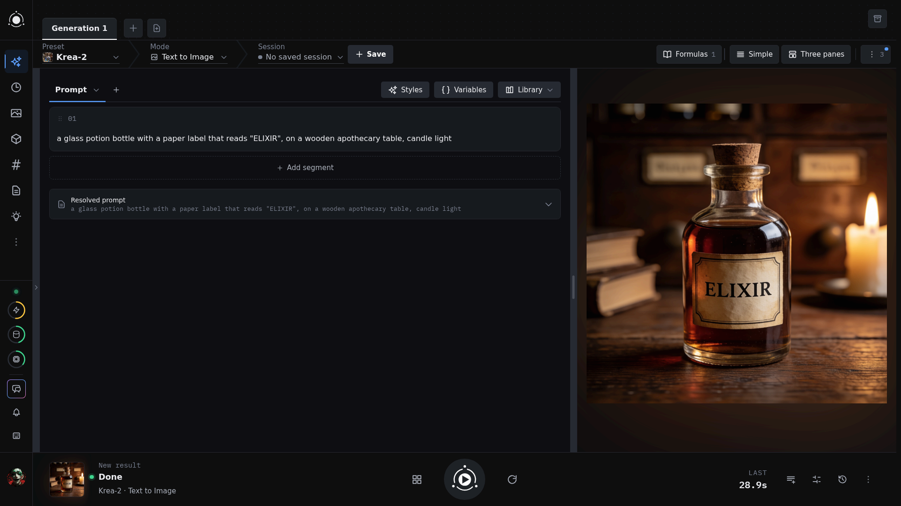

<details>
<summary>Watch the 60-second tour (video)</summary>

https://github.com/user-attachments/assets/950415f7-da97-403e-811b-4c9c41d8106f

</details>

</div>

**Why PotionUI:**

- **Forms, not wiring** — each model exposes only the controls it actually
  understands.
- **Accounts, groups, admin panel** — one GPU, many users, per-user presets
  and model access.
- **Drive it from Claude Desktop or any MCP client** — per-user tokens; every
  write action needs your approval.
- **Video Director** — compose shots in sections instead of one giant prompt.

*Alpha 0.0.17 · Linux x86_64 + NVIDIA · Windows native (experimental), WSL2 or
Docker ·
[Discord](https://discord.gg/avR4trp3b8) · [Reddit](https://www.reddit.com/r/PotionUI/) ·
[Ko-fi](https://ko-fi.com/A3B325D031)*

## 60 seconds to first image

```bash
git clone https://github.com/PotionUI/PotionUI.git potionui && cd potionui
./potionui doctor    # check prerequisites, with a repair command for anything missing
./potionui start     # create the venv, install deps, launch backend + frontend, print the URL
```

Native Windows (experimental): `.\potionui.cmd doctor` and `.\potionui.cmd start`
from PowerShell or cmd — see [Windows (native)](#windows-native).

Floor: 8 GB VRAM + 16 GB RAM (SDXL). Full requirements below.

## Contents

- [What you're looking at](#what-youre-looking-at)
- [Modes](#modes)
- [Multi-user, with an admin panel](#multi-user-with-an-admin-panel)
- [AI assistant](#ai-assistant)
- [The generate workspace](#the-generate-workspace)
- [History, tags, and collections](#history-tags-and-collections)
- [Video Director](#video-director)
- [Prompt tooling](#prompt-tooling)
- [Automations](#automations)
- [Plugins](#plugins)
- [Install](#install) — [supported platforms](#supported-platforms),
  [manual setup](#running-backend-and-frontend-separately)
- [Documentation](#documentation) · [Changelog](#changelog)
- [Contributing](#contributing) · [Support](#support) · [License](#license)

## What you're looking at

- **Pick a model, get the right controls** — each model ships a form with only
  the controls it understands: resolution, camera angle, art style, whatever
  applies.
- **Watch it happen live** — step-by-step progress, streaming previews, and a
  gallery that fills in as results land.
- **One app for all of it** — images, video, and audio side by side, no
  per-model setup.

| Model family       | What it does                              | Docs                                                           |
| ------------------ | ----------------------------------------- | -------------------------------------------------------------- |
| SDXL               | Image (txt2img, inpaint)                  | [docs/models/sdxl.md](docs/models/sdxl.md)                     |
| Flux (1 / 2 Klein) | Image (txt2img, img2img)                  | [docs/models/flux.md](docs/models/flux.md)                     |
| Qwen-Image         | Image (txt2img, img2img, edit, restyle)   | [docs/models/qwen_image.md](docs/models/qwen_image.md)         |
| Krea-2             | Image (txt2img, enhance)                  | [docs/models/krea2.md](docs/models/krea2.md)                   |
| Z-Image            | Image (txt2img)                           | [docs/models/z_image.md](docs/models/z_image.md)               |
| Anima              | Image (txt2img)                           | [docs/models/anima.md](docs/models/anima.md)                   |
| Wan 2.1 / 2.2      | Video                                     | [docs/models/wan.md](docs/models/wan.md)                       |
| LTX-2 / 2.3 / 2.5  | Video (with audio), video edit, upscale   | [docs/models/ltx.md](docs/models/ltx.md)                       |
| MiniMax-H3         | Video (with reference images), video edit | [docs/models/minimax_h3.md](docs/models/minimax_h3.md)         |
| MiniMax-Music3     | Audio (song)                              | [docs/models/minimax_music3.md](docs/models/minimax_music3.md) |
| YuE2               | Audio (song, lyrics + style tags)         | [docs/models/yue2.md](docs/models/yue2.md)                     |
| SeedVR2            | Image & video upscale / restore           | [docs/models/seedvr2.md](docs/models/seedvr2.md)               |

## Modes

A model does more than one job. The mode picker beside the preset switches
it, and the form changes to what that mode needs.

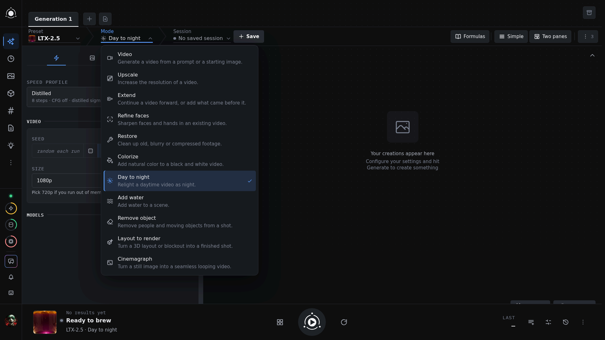

- **LTX-2.5** — beside Video and Upscale: Restore old or compressed footage,
  Colorize black-and-white video, relight it from Day to night, Add water,
  Remove object (people and moving things), Layout to render (a 3D blockout
  into a finished shot), Cinemagraph (a still into a seamless loop), Extend a
  clip forward or add what came before it, and Refine faces. Edit modes keep
  the source's audio and length.
- **MiniMax-H3** — beside Video and References to Video: Extend continues a
  video or adds a lead-in, Refine faces sharpens faces and hands, Remix
  re-creates a video with a change, Talking video makes a portrait speak a
  voice clip, and Upscale raises a clip's resolution with an optional Scene
  prompt.
- **Qwen-Image 2.1** — beside Text to Image, Edit image, and Structure: Edit
  text replaces or adds text in a picture, optionally only inside a painted
  box; Restyle changes the style, background, or lighting, or colorizes and
  restores a photo; Combine images edits one picture using up to nine others,
  each picked with **@** in the prompt.

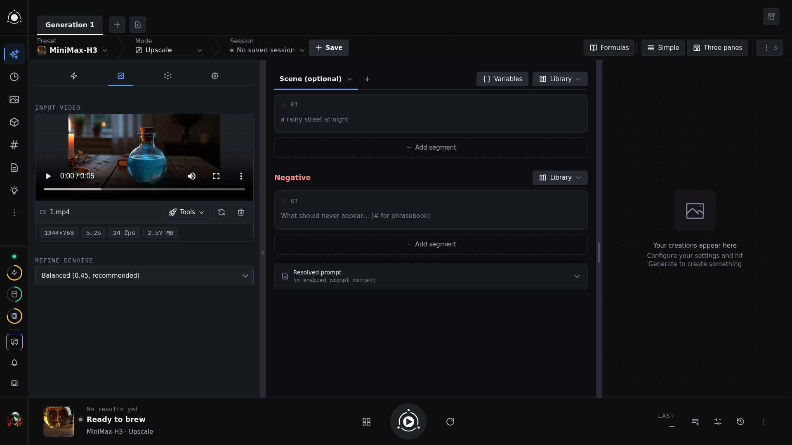

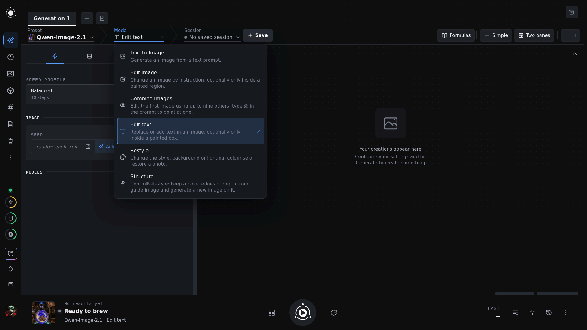

## Multi-user, with an admin panel

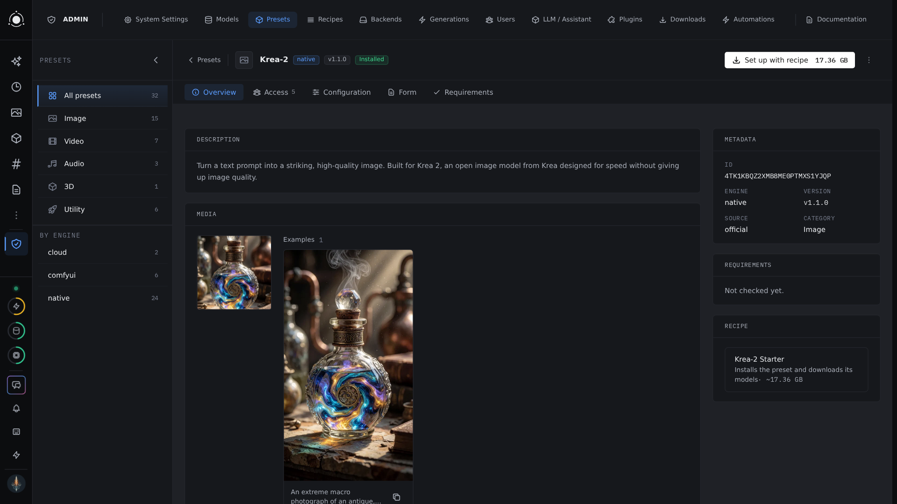

PotionUI is built for more than one person on the same box:

- **Users and groups** — create accounts, group them, and assign presets,
  models, and LLM configurations per user or to a whole group at once.
- **Presets under control** — decide who sees which preset, and reshape any
  preset's form per mode: change defaults, lock fields, or hide them
  entirely, no YAML editing required.
- **Backends** — configure where generations run and let users pick between
  enabled backends.
- **LLM setup** — wire up the providers behind the assistant (Ollama,
  OpenRouter, …) and hand them out per user or group.
- **Models, plugins, settings** — manage installed models and downloads,
  toggle plugins, and set global options, all from the same panel.

The full tour: [docs/user/admin.md](docs/user/admin.md).

## AI assistant

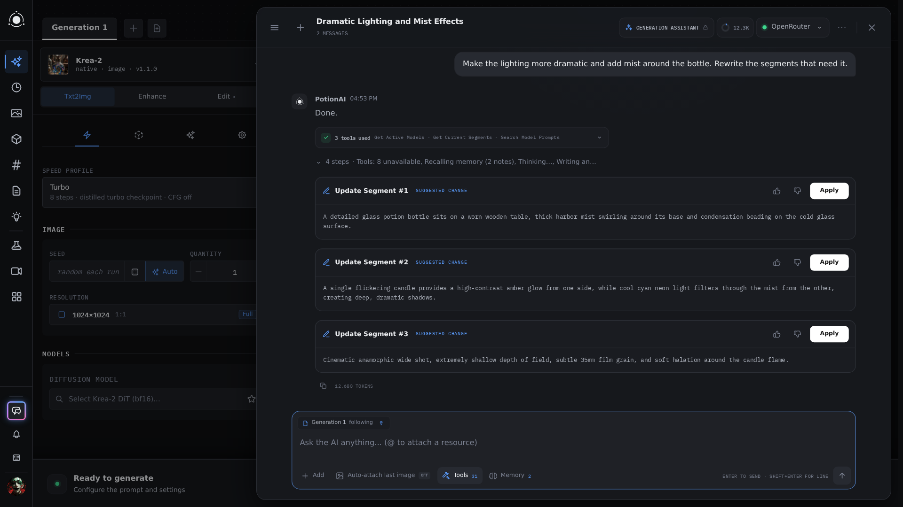

- Configure a language model and get an assistant beside generation: it
  brainstorms and rewrites prompts, edits phrasebook values, adjusts form
  state — **with your approval on every action that changes something**.
- The same tools are reachable from outside the app: PotionUI mints per-user
  [Model Context Protocol](https://modelcontextprotocol.io) tokens, so an MCP
  client (Claude Desktop, an agent, your own tooling) can drive your instance
  directly.

## The generate workspace

<!--
SCREENSHOT SLOT — GENERATE / VIDEO PRESET
A video preset selected (Wan or LTX), curated form visible (resolution,
frames, sampler), generation in progress with the live streaming preview
and a step progress bar mid-run.
-->

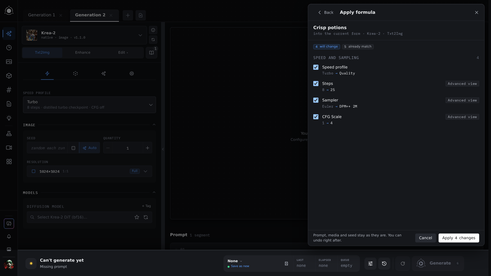

- Every tab is its own sandbox — preset, mode, prompts, and results — so you
  can run several ideas side by side without losing any of them.
- Switch models and the form swaps to match; the same tab handles txt2img,
  img2img, inpainting, or a video/audio mode.
- Like a setup? Save it as a **session** — preset, mode, prompts, and form
  values — and pull it back up any time.
- Save the settings that worked as a **formula** and apply them in any
  session, with a preview of exactly what changes.
- One media field holds reference images, videos, and audio in their own
  groups; type **@** in the prompt to use any of them.

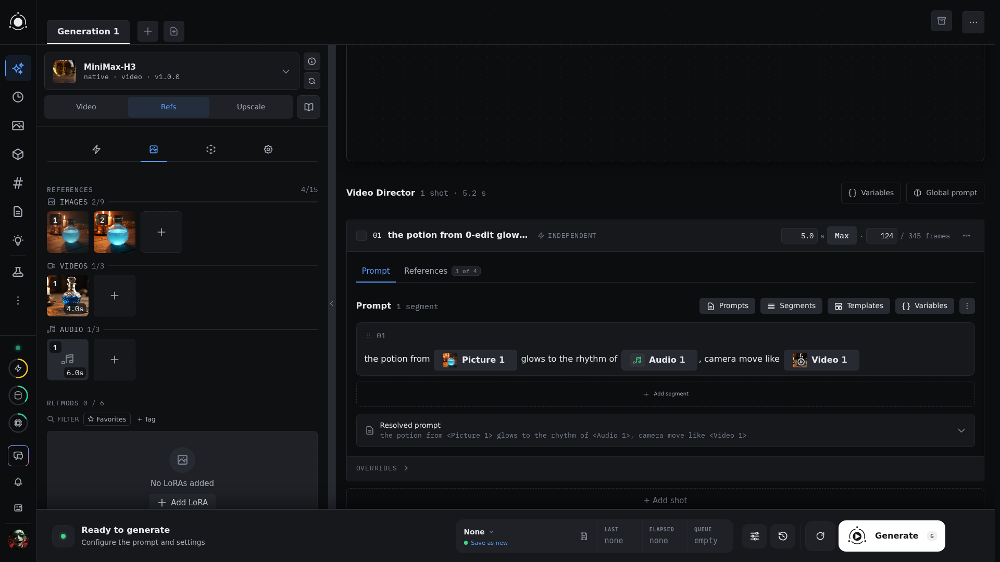

## History, tags, and collections

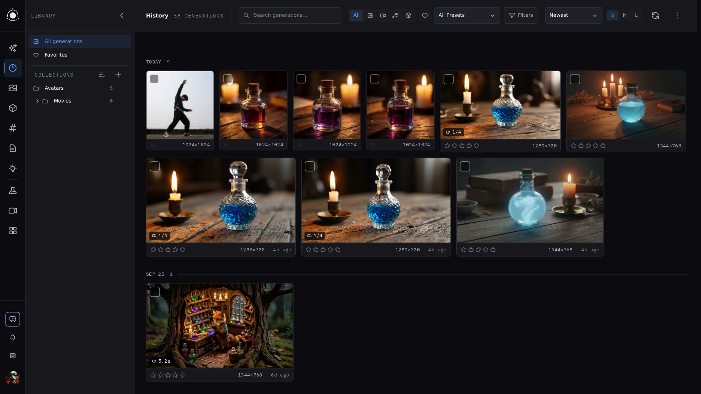

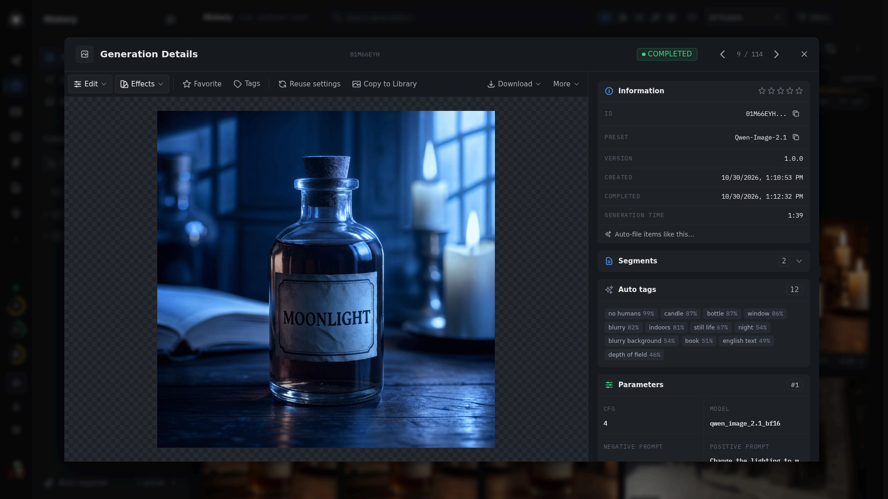

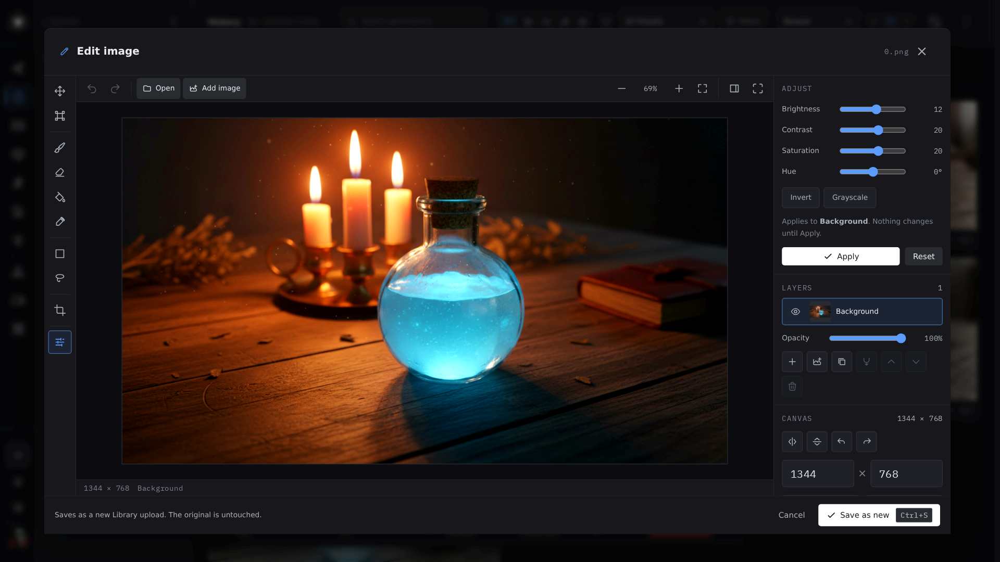

https://github.com/user-attachments/assets/f46cde26-0288-4e05-ac90-c3be31f0d2dd

- Everything you generate is saved automatically, with the exact parameters
  that produced it.
- Tag generations to group and re-find them; bulk-delete by tag to clear out
  throwaway experiments.
- Sort work into collections, and compare two results side by side.
- Fix a picture without leaving the app: Edit → Edit image adjusts, crops,
  paints, and layers it, then saves a new copy. The same editor opens from
  any media field in a preset form.

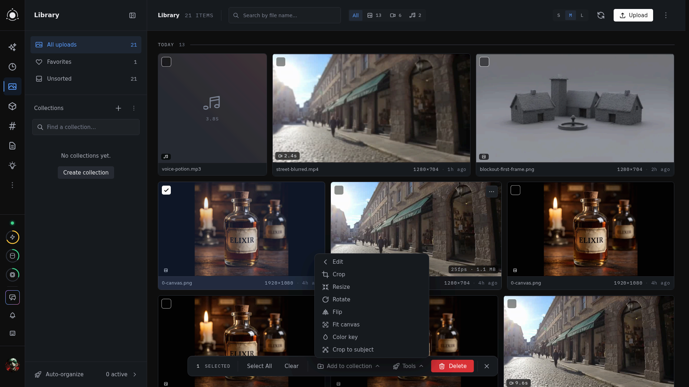

**Media tools** — one catalog of tools works on Library and History items,
from the Tools menu, a card's menu, or the details action bar: Edit holds
trim, crop, resize, rotate, flip, speed, fit canvas, color key, crop to
subject, frame grab, split, and concat, and Effects applies photo-filter
looks. A run goes to the background with progress and Cancel on its card. On
a Library item each tool's dialog offers Save as new or Replace original; an
edit started from History saves a copy to the Library and leaves the
generation as it was. PotionAI, automations, and presets can run the same
tools, and plugins can add their own.

## Video Director

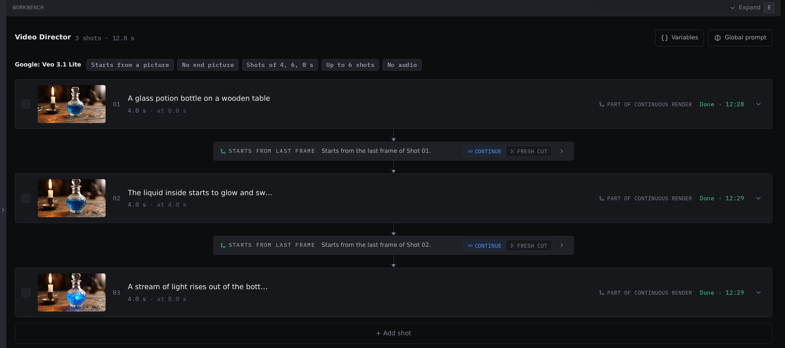

- Build a shot out of **global, timed, and chained sections** instead of
  hand-managing separate prompt fields per segment.
- Same segment-card editor as everywhere else in PotionUI, aimed at a
  timeline.

## Prompt tooling

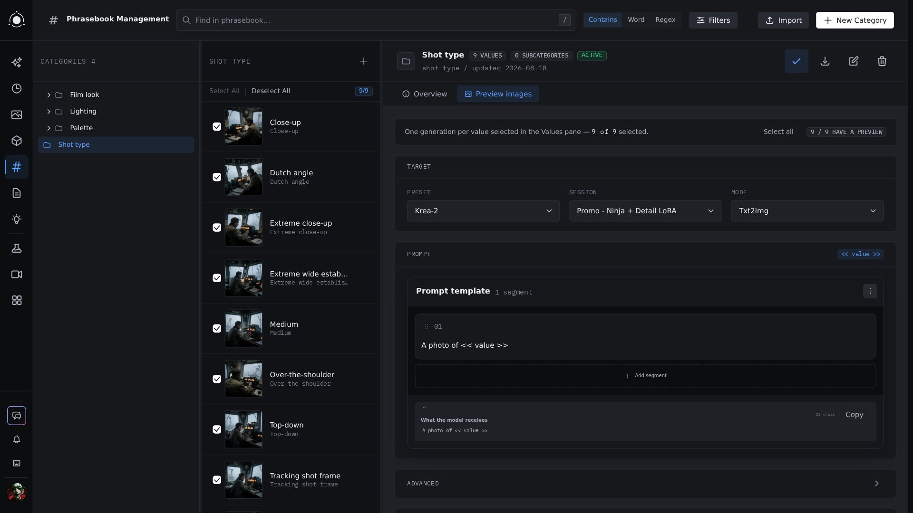

- **Segments** — save a prompt fragment once, drop it into any prompt; group
  related segments into templates.
- **Phrasebook** — autocomplete for known terms (art styles, camera angles,
  lighting) with per-chip shuffle for quick variation.
- **Dynamic prompts** — `{a|b}`, weighted choices, `${vars}`.
- **LLM enhancement** — optional, layered on the same editor.

## Automations

- Wire **triggers** (schedule, manual, file watcher, GPU VRAM threshold, app
  events) through **conditions** to **actions** (tag, add to a collection,
  assign models or users, backend actions, notifications, indexing) on a
  visual graph.
- Start from an importable template, export as JSON, and read every run's
  history and logs in the same editor.

## Plugins

Nearly every subsystem is an extension point — even alternate inference
backends are plugins, not core code:

- **Providers** — credentialed connections to model marketplaces (e.g. CivitAI)
- **Backends** — configured instances of an inference engine (e.g. a ComfyUI
  server via the `comfyui-backend` plugin, which also ships image presets for
  SDXL, Qwen-Image, Z-Image, Krea-2, and Flux Klein 9B); you can import your
  own ComfyUI workflows as presets too — see
  [docs/presets/comfyui.md](docs/presets/comfyui.md); hosted cloud models
  come from the `openrouter-provider`, `bfl-provider`,
  `google-gemini-provider` and `openai-provider` plugins, each with its own
  presets — see [docs/cloud-models.md](docs/cloud-models.md)
- **Pipes** — the individual steps a generation pipeline is built from
- **Field types, chat modes, frontend pages** — all pluggable

Plugin code imports only from `src/plugin_api/`. Authoring reference:
[docs/plugin-api.md](docs/plugin-api.md).

## Install

> [!WARNING]
> PotionUI is in **alpha**: expect rough edges and breaking changes between
> releases. Back up anything you care about, and report what breaks — issues
> and Discord reports steer what gets fixed next.

> [!IMPORTANT]
> **Linux x86_64 with an NVIDIA GPU** is the tested 0.0.17 matrix. **Native
> Windows is supported experimentally** as of 0.0.8: the installer, the CLI,
> the backend test suite, the frontend checks and the E2E harness all run in
> CI on `windows-latest` — see [Windows (native)](#windows-native) below.
> WSL2 and Docker Desktop work too. Details in
> [Supported platforms](#supported-platforms).

PotionUI can generate on this machine's GPU, dispatch to a remote worker, or
both — the `./potionui` CLI has an install preset for each.

**Pick an install:**

| You have                                              | What gets installed                                                 | Command                             |
| ------------------------------------------------------ | ----------------------------------------------------------------- | -------------------------------------- |
| A GPU in this machine                                 | Full CUDA stack                                                    | `./potionui start`                     |
| A GPU here, plus room to add remote workers later      | Full CUDA stack                                                    | `./potionui start --profile hybrid`    |
| No GPU here (a VPS or laptop) — dispatch to a worker    | CPU-only PyTorch, no CUDA libraries — **not** a CPU-generation mode | `./potionui start --profile remote`    |
| A GPU box that only serves another PotionUI instance    | Full CUDA stack, no frontend                                       | `./potionui worker start`              |

On native Windows every command reads `.\potionui.cmd …` instead of
`./potionui …`; the profiles are the same.

You need:

- **Python 3.12** (3.13 works only by compiling numpy from source; the shim prefers 3.12 when both exist), and **Node.js 22+** (24 LTS recommended) for every preset except Worker.
- Floor: **8 GB VRAM + 16 GB RAM** (runs the SDXL family) on any preset that
  installs the CUDA stack. Larger families need more, some considerably more
  — see [Hardware Requirements](docs/user/hardware-requirements.md).

```bash
git clone https://github.com/PotionUI/PotionUI.git potionui && cd potionui
./potionui doctor    # check prerequisites, with a repair command for anything missing
./potionui start     # create the venv, install deps, launch backend + frontend, print the URL
```

- `./potionui start` is idempotent and supervises both processes; `./potionui stop`
  or Ctrl-C cleans them up together.
- `./potionui status` reports whether an instance is up; `./potionui doctor`
  names any problem and its fix.

### Supported platforms

| Platform                    | Status                                                                                      |
| --------------------------- | ------------------------------------------------------------------------------------------- |
| Linux x86_64 + NVIDIA CUDA  | Tested and supported for 0.0.17                                                              |
| Windows via WSL2            | Should work — same Linux CUDA stack, just unverified; a success/failure report would help   |
| Windows native              | Experimental (0.0.8) — installer, CLI, backend suite, frontend checks and E2E harness run in CI on `windows-latest`; see [Windows (native)](#windows-native) |
| macOS                       | No — local generation needs CUDA; the native engine has no MPS support                      |
| AMD GPU (ROCm)              | No — the pinned dependency stack is CUDA-only                                               |
| Docker                      | Supported — see below (on Windows, Docker Desktop runs this via WSL2)                       |

### Windows (native)

Experimental as of 0.0.8. The `windows-latest` GitHub Actions workflow
([`.github/workflows/windows.yml`](.github/workflows/windows.yml)) covers
the install and test matrix below.

**Prerequisites:**

- Python 3.12 from [python.org](https://www.python.org/downloads/windows/)
  (the `py` launcher works too; 3.13 is not yet usable because the pinned
  numpy has no 3.13 wheels).
- Node.js 22+ (24 LTS recommended).
- Git.
- For GPU generation: an NVIDIA driver version 580 or newer (the floor the
  CUDA 13 torch build in `constraints.txt` needs — see
  [Hardware Requirements](docs/user/hardware-requirements.md)).

```powershell
git clone https://github.com/PotionUI/PotionUI.git potionui
cd potionui
.\potionui.cmd start
```

**Exercised in CI on `windows-latest`:** `doctor`; the `remote` install
profile (CPU-only PyTorch, no CUDA) booting end to end — install, backend
start, health check, owner registration, preset listing, stop — on a fresh
checkout; the full backend pytest suite and the marketplace plugin suites;
the release gate without GPU steps; the frontend type-check, unit, component
and build steps; and the HTTP + Playwright E2E harness.

**Known limitation:** Triton and `torch.compile` have no Windows wheels, so
attention runs on plain SDPA and the compile optimizations stay off.

**Reporting a Windows issue:** open a GitHub issue with:

- The output of `potionui.cmd doctor --json`.
- The files under `logs/`.
- The output of `nvidia-smi`.
- What happened when you generated with the smallest available preset.

```bash
docker run --gpus all -p 26730:26730 ghcr.io/potionui/potionui:latest
```

Requires an NVIDIA GPU +
[nvidia-container-toolkit](https://github.com/NVIDIA/nvidia-container-toolkit);
volumes and details in [`docker/README.md`](docker/README.md).
(`./potionui start-docker` runs the contributor-facing dev harness instead.)

### Running backend and frontend separately

Useful when iterating on one side only, or if `./potionui` doesn't fit your
setup:

```bash
# Backend
python -m venv venv
source venv/bin/activate          # Windows (native, experimental): venv\Scripts\activate
pip install -r requirements.txt -c constraints.txt
python api.py                     # serves on http://localhost:26730

# Frontend
cd frontend
npm install
npm run dev                       # dev server on http://localhost:26731
```

Or run both together with `./run.sh` (assumes the venv and `node_modules` are
already installed — `./potionui start` does not):

```bash
./run.sh                          # backend :26730, frontend :26731
./run.sh 26730 26731 --lan        # also accept connections from the local network
```

### Logs

Console output is mirrored to a rotating log file at `storage/logs/potionui.log`.
Tune it with `POTIONUI_LOG_LEVEL` (default `INFO`), `POTIONUI_LOG_DIR` (default
`storage/logs`, empty disables the file), `POTIONUI_LOG_MAX_BYTES` (default
20 MB) and `POTIONUI_LOG_BACKUP_COUNT` (default 10), or turn the file off
outright with `POTIONUI_LOG_FILE=off`. Details in
[Administration → Server logs](docs/user/admin.md#server-logs).

## Documentation

Start with the in-app documentation browser, or read the Markdown directly:

- **[Getting started](docs/user/getting-started.md)** — first login to first
  image, plus the rest of the `docs/user/` guide.
- **Reference** in `docs/`: [presets](docs/presets.md),
  [prompts](docs/prompts.md), [backends](docs/backends.md),
  [providers](docs/providers.md), [native engine](docs/native-engine.md),
  [models](docs/models.md), [video director](docs/video-director.md),
  [music director](docs/music-director.md), and per-model / per-technique
  docs under `docs/models/` and `docs/techniques/`.

## Changelog

The three most recent releases; older history lives in the
[commit log](https://github.com/PotionUI/PotionUI/commits/master).

### 0.0.17 — 2026-10-22

- Model indexing: a scan only lists files and reads headers, so models are usable at once, and
  hashing runs afterwards in a paced, low-priority pool that pauses during generation and that an
  admin can slow down or pause; a first-run choice (index all, pick models or later) is asked after
  setup instead of over the wizard, onboarding never waits for hashing, and recipes verify at most
  two same-size files before downloading.
- Prompts: if / else if / otherwise conditions pick text per image from a prompt's variables, edited
  in a wide condition editor (typing << opens it) with a per-image preview and warnings for
  unfinished branches; Number variables join Choice variables; variables are kept on the server per
  user, where PotionAI and MCP can read and change them; PotionAI understands conditions and can add
  or delete segments; a literal $, % or # is plain text instead of silently switching off every
  choice; Save as prompt keeps every variable.
- Generate: a context toolbar under the tabs holds preset, mode, variant and session on the left and
  Save plus the tools on the right; the preset dropdown has search, Recent, Pinned and families, and
  a preset without a backend can be picked with Generate disabled and the reason shown; the
  generation panel becomes a now-playing deck with a result thumbnail and a soft glow of the last
  result; tabs show a dot for unsaved session changes, sessions can be reloaded from the last
  snapshot, and a required model slot fills itself when one installed model matches.
- History: cards show run time; `/history?generation=<id>` opens a generation's Details; deleting an
  X/Y compare removes the whole compare after one confirm; History, Library, Prompts, Inspirations
  and Models share a redesigned collections sidebar with search, Include subcollections and a phone
  sheet; prompt search is faster.
- Model Tools: a new admin-only preset for the local native backend quantizes to FP8, INT8, INT8
  ConvRot, NVFP4 or INT4 ConvRot, bakes LoRA and LoKr into a model and merges LoRAs, writing the
  result next to its source as a model card in the Workbench and History; layers a format cannot
  hold stay in source precision and are reported; FLUX 3 Klein loads fused-QKV INT8 ConvRot
  checkpoints, LoRAs included, and INT4 ConvRot files load too.
- Native engine: MOSS-Image arrives with SFT and Base presets, a LoRA tab, a starter recipe and an
  optional step cache; Krea-2 gets an experimental Text Enhancer (off by default) for stronger
  prompt adherence and a Text Scale slider; torch.compile also runs on fp8-scaled and streamed DiTs;
  a streamed MiniMax-H3 pins 19.5 GB of system memory instead of 30.6 GB and keeps more of long
  clips on the GPU.
- Chat: a configuration's Show thinking to users switch (off by default) shows the model's reasoning
  in a foldable block above each reply, live with a timer and never sent back as context; Ollama's
  Thinking Mode loses Automatic; LLM configurations get one Context window field with a Detect
  button, detected from the server or checkpoint when unset; chat sends shorter prompts and only the
  tools a mode and window need.
- Sign-in: the OIDC plugin can send signed-out visitors straight to the identity provider (off by
  default), with `/login?local=1` as the local recovery form; every login returns to the page you
  were on; registration accepts local-domain emails; MCP generation tools return a details link per
  generation, built from a new Public address setting or the request's origin.
- Automations and plugins: an admin-only HTTP request action with a test panel, a public-address
  guard and encrypted secret headers; Auto-organize can file generations by Media Tagging tags;
  plugin pages call the app through an authenticated host API; Admin > Presets keeps its open tab in
  the URL; the account menu links to the community.
- Phones and keyboard: Chat sits in the bottom nav on every page, the deck sits above the tab bar,
  and headers, Generation Details and confirm dialogs fit a phone; focus rings show only while the
  keyboard is in use, tooltips open on keyboard focus, Escape closes only the topmost popover, and
  shortcut hints show the command key on macOS.
- Pinokio: media loads when PotionUI is embedded in Pinokio's window.
- Reliability: the backend keeps serving past 10,000 requests; History queries are indexed; heavy
  calls no longer block the server; unexpected errors no longer leak text or paths to regular users.
- Fixes: Krea-2 Enhance no longer leaves noise; cancelling a cloud generation on a provider that
  cannot cancel shows the calm notice; approving a prompt-variable change in chat reports what was
  applied; the $, /, @ and # pickers insert at the typed character in a multi-line prompt; typing in
  a choice group's options no longer triggers global shortcuts; MiniMax-H3 finds the bundled ffmpeg
  and fails before sampling rather than after; Model Browser previews load without a referrer.
- Upgrading: Ollama configurations on Thinking Mode Automatic (off during tool calls, on otherwise)
  become Disabled, and thinking stays hidden until Show thinking to users is on; installs where any
  model already had a hash keep verifying in the background, while one with none and a large library
  (over 20 files or 64 GiB) is asked once and hashes nothing until it answers, models being usable
  either way; prompt variables kept in the browser move to the server on first load; a stored S3
  secret key and plugin credentials saved in clear are encrypted on first start; the installer needs
  Node.js 22 or newer.

### 0.0.16 — 2026-10-16

- FLUX 3 Klein (experimental): the native engine runs FLUX 3 Image Klein checkpoints, base and
  distilled, with their own text encoder and autoencoder; a new FLUX 3 Klein preset does text-to-image
  and multi-reference edit, and its steps and CFG follow whichever checkpoint is loaded; it is
  marked experimental until it has had wider testing.
- Model Browser: a new marketplace plugin lets users browse CivitAI, Hugging Face and OpenModelDB
  from PotionUI and download a model straight into the right folder; admins decide per user group
  who may browse, download, request or approve, from which sources, which model types and up to
  which size, and previews follow the instance's sensitive-content policy; users without the
  download right can request a file and get notified when it is approved or declined, and admins
  can cap files and bytes downloaded per month in Plans.
- Prompt variables: the variables window lists every variable on the left and edits the selected
  one on the right, marks with a tick each variable the prompt actually uses, and has no limit on
  how many variables a prompt can have; a choice variable used several times can roll each usage
  on its own or share one roll, and each usage chip shows which one it is.
- Batch prompts: several prompts can run as one generation that encodes every prompt once and
  lands as one History entry per prompt.
- X/Y compare: running cells show real step counts; a finished grid sends one notification
  instead of one per cell, and a grid where every cell failed says so once; History captions use
  the axis names you picked; the LoRA axis shows the LoRA names; the Stitch window no longer jumps
  in height while it loads, and the grid's left edge no longer shows cells when you scroll sideways.
- Chat: approving a tool call happens in a card inside the reply and continues the same answer, so
  an approval no longer times out, loses the conversation or ends without a reply.
- Search: History, gallery and chat search find generations whose prompt was written in the
  segmented prompt editor; text that only appears in the negative prompt no longer matches.
- Sessions: you stay signed in while you use the app, a valid sign-in survives a backend restart,
  and adding an account whose session expired switches to it.
- Plugins: plugins get their disable signal on every teardown, including a rescan, a reload, a
  removed folder and an uninstall, and start again cleanly after a reload; a plugin folder can be
  a symlink or a Windows junction, and a broken link is skipped with a warning instead of stopping
  the plugin build; new plugin API for reacting to finished downloads, queueing downloads, user
  groups, content policy, notifications and plan limits; relative imports inside a plugin no
  longer print a warning.
- Native engine: a Qwen-Image 2.1 multi-reference edit with CFG no longer runs out of VRAM; LoRA
  stages release their GPU memory once done and fp8 and nvfp4 LoRA runs need less headroom; models
  that are no longer used give back their pinned system memory.
- Responsiveness: uploads, edits, storage and limit checks and grid saves no longer block the
  server; the image editor loads only when opened, and compare progress no longer redraws the
  whole form.
- Fixes: a plugin setting switched off in Admin > Plugins > Settings stays off after Save;
  cancelling a Video Director run reports the stopped shots correctly; group tabs in Admin > Users
  & Groups no longer reload in a loop after a failed load; frontend dependencies pick up patched
  security releases.
- Upgrading: History and gallery search now look only at prompt text, preset and model names, so
  a seed or another form value no longer finds a generation.

### 0.0.15 — 2026-10-08

- X/Y compare: a Compare button in the Generate dock turns any form into a grid; pick the fields
  for the X and Y axes, give each its values, and one Generate runs a cell per combination; the
  Workbench fills the grid live with each cell's time, video grids play in sync, and a finished
  grid can be stitched into one image; History keeps a grid as one stack card that opens the grid,
  and each cell's details say which X and Y values it used; axes follow what the chosen model
  supports, including cloud options such as aspect ratio and quality, and the phone Studio view
  shows the grid too.
- Photo filters: the image editor has a Filters tool with twelve built-in looks, an intensity
  slider and fine-tuning; a look you like can be saved as your own filter, kept per user; plugins
  can add filters and the operations behind them, and filters render the same in the browser and
  on the server.
- Auto-organize: per-user rules file new generations, uploads and models into collections and
  tags; a rule can match media kind, size and aspect, and for models their name, file name,
  description, trigger words, source, file size and custom attributes; preview a rule before
  saving, apply it to existing items, and undo from its activity list; collections now include
  sub-collections by default, with direct-only, Unsorted and Favorites filters and rolled-up
  counts in History, Library, Models, Inspirations and Prompts, and prompts can be favorited.
- Plans and limits: admins can cap storage, daily generations, monthly cloud spend and the size of
  a single upload per user, through a default plan, group plans and personal overrides; users see
  their plan and usage in Settings, a limit bar in the account menu and a storage card in History
  with Review largest generations, and a refused generation or upload says why with a live
  countdown; deleting a plan in use offers to reassign its users.
- Cloud models: three new provider plugins join OpenRouter; OpenAI runs GPT Image text to image
  and edit with references and a painted mask, Google Gemini runs Nano Banana image and Veo 3.1
  video models, and Black Forest Labs runs FLUX models, each with its own preset and setup guide;
  the cloud catalog can show suggested models and links to each model's page; changing the engine
  in Add backend keeps the name, enabled flag, priority and scheduling.
- Accounts: one browser can hold several accounts and switch between them from the user menu or
  the phone Accounts sheet, each with its own tabs and saved state; with the OIDC plugin, Add
  account can offer another identity; the user panel groups its entries into Accounts, Workspace,
  Content and Session.
- Generate: the header is one row with the preset picker, a mode select with plain mode names,
  short descriptions and optional icons, and formulas; the form hides its tab bar when only one
  tab is visible; the negative prompt hides while the current guidance would ignore it, and
  presets can declare this per mode; the Resolved prompt row shows variable values and marks the
  ones that re-roll per image; prompt header actions collapse into the More menu as the pane
  narrows; a picked model clears in one click in filters and optional model fields, and History
  filters pick a model with the model picker.
- History and Library: each card has a Delete button and an item actions menu in place of the
  quick-action row, and the controls stay readable on any image; the media field's History picker
  offers every file of a generation as its own tile.
- Native engine: LoRAs on fp8 and nvfp4 models are added in one fused step instead of slowing
  every layer, and LoKr adapters stay on the fast path; LTX-2.5 IC-LoRA references accept videos
  in Video Director, honour the LoRA's reference scaling, steer the first pass only with an
  optional refine-pass toggle, and work with Upscale; engine tuning (attention backend, compile,
  prefetch and similar) lives in each native backend's Optimizations tab and is sent to remote
  workers with every job, and profiling is a Diagnostics setting.
- 3D: a new Pixal3D preset turns one image or four views into a textured mesh, estimating the
  camera's field of view on its own; TRELLIS.2 mesh export is several times faster, with UV unwrap
  in seconds instead of minutes and cleanup in a separate process so the server stays responsive;
  it remeshes and bakes textures the way upstream does, defaults to 300k faces with up to 1M
  available, and no longer exports a vertically mirrored texture.
- Chat and MCP: MCP tools work without an open browser tab (list presets and models, edit
  segments, templates and phrasebook categories, search the gallery by text); prompts can be read
  and listed from MCP and chat; library listings are complete and respect hidden generations;
  tool, streaming, automation and notification failures show regular users a plain message and
  admins the detail.
- Plugins: a plugin can declare setup steps, and one with setup left shows a Setup needed badge
  and a Setup section with the next step first; plugin admin tabs can draw their own page with a
  left menu; plugins can add Auto-organize conditions and actions and their own limit kinds.
- Admin: assigning users, groups, resource access and plans uses one shared picker with whole-row
  toggle, shift-click ranges and keyboard control; Auto-organize has an admin page with Overview,
  Limits and People; presets show where they were loaded from.
- Fixes: Edit image on a media field works right after an upload and is not offered while the
  upload is still processing; a chosen sampler survives closing the form, switching tabs and
  reloading a session; switching Krea-2 NAG off really turns it off; a model already in memory no
  longer shows a "Loading model" status before each generation; a generation cancelled just as a
  queue slot frees no longer starts, so a cancelled cloud run never reaches the provider; two
  PotionUI instances on one host no longer break each other's images; model previews picked from
  History show for every user the model is assigned to; failed generations tell regular users what
  happened in plain words; new generation tabs never show the previous tab's form; the phone
  Settings sheet fills in its tabs once the server answers; phrasebook chips on wrapped lines no
  longer overlap; the Trim end handle is no longer clipped; daily limits work on Windows.
- Upgrading: generated images, uploads, run reports, inspirations and avatars now need a signed-in
  viewer, so other users get a 404 and a bare media link opened outside a logged-in browser no
  longer loads; engine tuning set through environment variables is copied into Admin settings on
  first start and the variables are ignored afterwards (a startup warning names any still set), so
  change it in each native backend's Optimizations tab; tzdata is a new requirement, so reinstall
  requirements on a manual install.

## Contributing

- **[CONTRIBUTING.md](CONTRIBUTING.md)** — dev setup, test and lint commands,
  PR expectations.
- `CLAUDE.md` — the deeper architecture reference; its package-layering rules
  are enforced by `tests/architecture/test_layering.py`, so boundary-crossing
  code fails CI.
- Security issue? See [SECURITY.md](SECURITY.md).

## Support

If PotionUI is useful to you, a [Ko-fi](https://ko-fi.com/A3B325D031)
contribution helps keep it going, and the
[Discord](https://discord.gg/avR4trp3b8) is where development happens in the
open. News, showcases and questions also go to
[r/PotionUI](https://www.reddit.com/r/PotionUI/).

## License

- PotionUI is **GPL-3.0** — see [LICENSE](LICENSE).
- Third-party code is bundled under `vendor/`, each component keeping its own
  upstream license; the GPL-3.0 components among it set the project-wide
  license. Full attribution: [vendor/NOTICE.md](vendor/NOTICE.md).
- **No model weights are distributed** — models download only at your explicit
  request, each under its own license, separate from PotionUI's. See
  [Models & licensing](docs/user/models.md#model-licensing).

---

[Docs](docs/user/getting-started.md) ·
[Discord](https://discord.gg/avR4trp3b8) ·
[Contributing](CONTRIBUTING.md)
