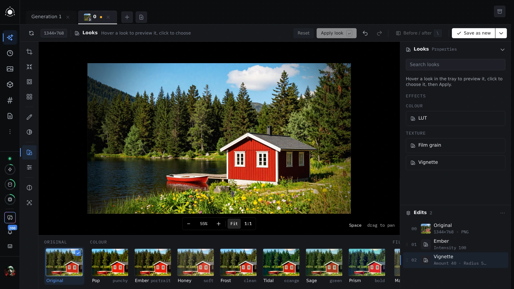
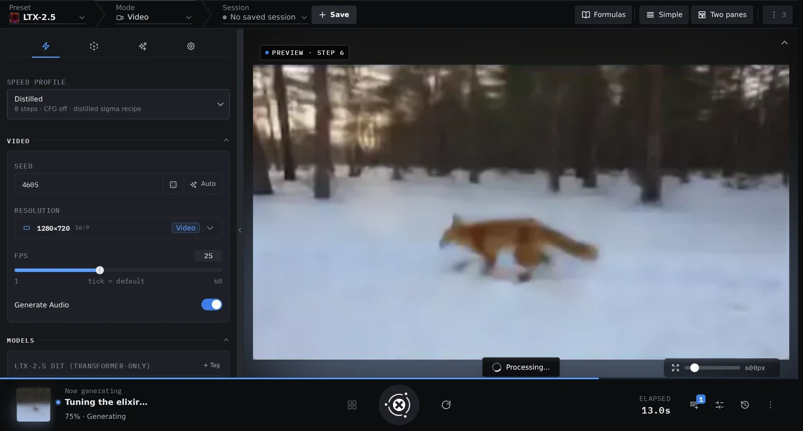
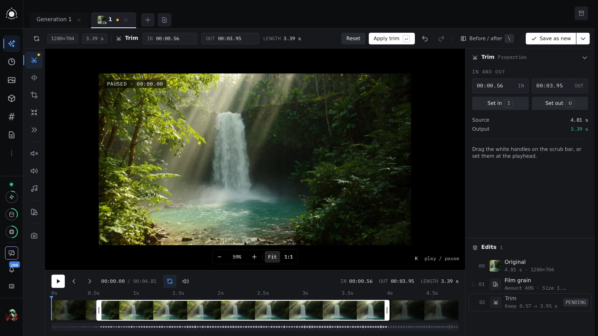
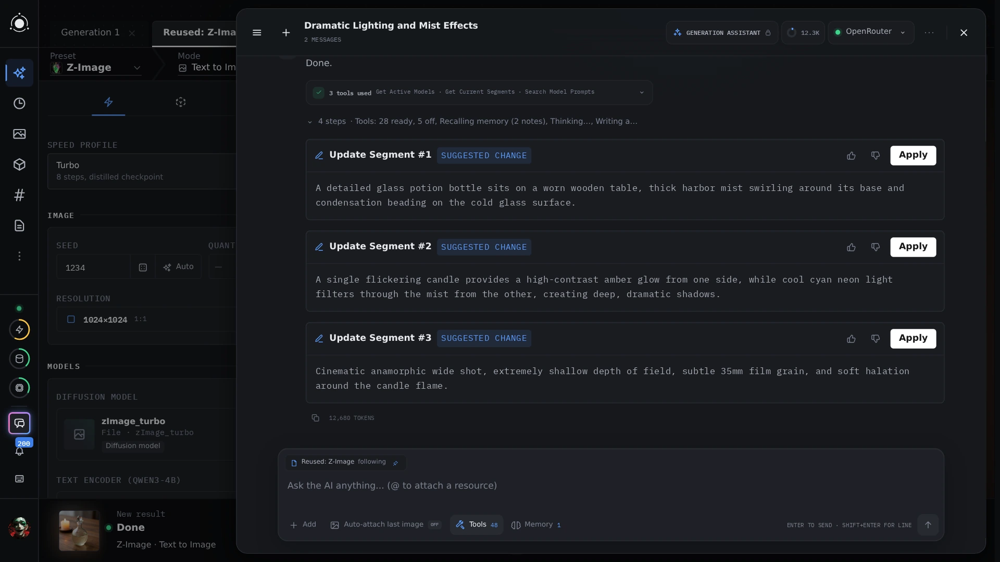
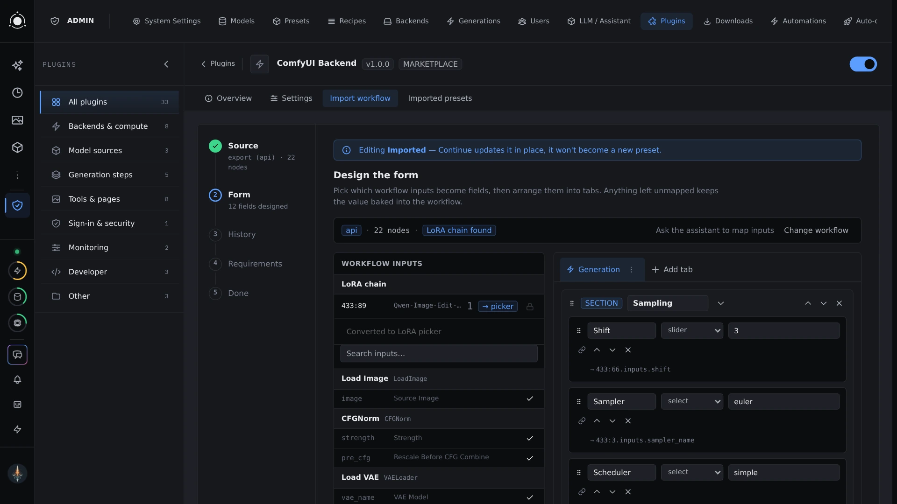

<div align="center">

<picture>
  <source media="(prefers-color-scheme: dark)" srcset="docs/media/brand/potionui-mark-light-256.png">
  
</picture>

# PotionUI

**The self-hosted generation studio you can hand to other people.**

Images, video and music on your own GPU · Free and open source · Linux & Windows

[](https://github.com/PotionUI/PotionUI/releases)
[](https://github.com/PotionUI/PotionUI/actions/workflows/backend-tests.yml)
[](LICENSE)
[](https://github.com/PotionUI/PotionUI/stargazers)
[](#install)

[](https://discord.gg/avR4trp3b8)
[](https://www.reddit.com/r/PotionUI/)
[](https://ko-fi.com/A3B325D031)

**[Install](#install)** · [Quick start](#60-seconds-to-first-image) · [Website](https://potionui.com) · [Docs](https://potionui.com/docs) · [Changelog](#changelog) · [Contributing](CONTRIBUTING.md) · [Security](SECURITY.md)

Run Krea-2, Anima, SDXL, Flux, Wan, LTX, Qwen-Image, MiniMax and YuE2 on one box — then give your team, your household, or your agents their own logins, presets, and limits. No node graphs. No per-model setup. Pick a model, type, watch it render live.


<details>
<summary>Watch the 60-second tour (video)</summary>

https://github.com/user-attachments/assets/950415f7-da97-403e-811b-4c9c41d8106f

</details>

</div>

**Why PotionUI:**

- **Forms, not wiring** — each model exposes only the controls it actually
  understands.
- **Accounts, groups, admin panel** — one GPU, many users, per-user presets
  and model access.
- **Drive it from Claude Desktop or any MCP client** — per-user tokens; every
  write action needs your approval.
- **Video Director** — compose shots in sections instead of one giant prompt.

*Beta 0.2.0 · Linux and Windows x86_64 + NVIDIA · WSL2 or
Docker ·
[Discord](https://discord.gg/avR4trp3b8) · [Reddit](https://www.reddit.com/r/PotionUI/) ·
[Ko-fi](https://ko-fi.com/A3B325D031)*

## 60 seconds to first image

PotionUI is a self-hosted app for generating images, video and music with your own GPU, built to be shared: every person gets their own login, presets and limits. Pick a model, type, and watch it render live.

```bash
git clone https://github.com/PotionUI/PotionUI.git potionui && cd potionui
./potionui doctor    # check prerequisites, with a repair command for anything missing
./potionui start     # create the venv, install deps, launch backend + frontend, print the URL
```

Native Windows: `.\potionui.cmd doctor` and `.\potionui.cmd start` from PowerShell or cmd.

Floor: 8 GB VRAM + 16 GB RAM (SDXL). More in [Install](#install).

## What you can do

<table>
<tr>
<td width="45%" valign="top"></td>
<td valign="top"><b>Generate images</b><br>Pick a model and get a form with only the controls it understands. Previews stream in while it renders, and every tab keeps its own preset, prompts and results.<br><a href="docs/user/generating.md">Generating images</a></td>
</tr>
<tr>
<td width="45%" valign="top"></td>
<td valign="top"><b>Edit images</b><br>Edit with the Qwen-Image and FLUX 3 edit modes, or fix a picture in the built-in editor: adjust, crop, paint and layer, then save a new copy.<br><a href="docs/user/history-and-tags.md">Image editing</a></td>
</tr>
<tr>
<td width="45%" valign="top"></td>
<td valign="top"><b>Generate video</b><br>Text to video and image to video with Wan, LTX and MiniMax-H3 (which also takes reference images), with audio where the model makes it. Each model's modes sit behind one picker.<br><a href="docs/models/ltx.md">Video models</a></td>
</tr>
<tr>
<td width="45%" valign="top"></td>
<td valign="top"><b>Edit video</b><br>Restore, colorize, relight, extend, remove objects, refine faces and upscale a clip, keeping the source's audio and length.<br><a href="docs/models/ltx.md">LTX modes</a></td>
</tr>
<tr>
<td width="45%" valign="top"></td>
<td valign="top"><b>Video Director</b><br>Compose a video from global, timed and chained sections instead of one giant prompt, each shot starting from the last frame of the one before.<br><a href="docs/video-director.md">Video Director</a></td>
</tr>
<tr>
<td width="45%" valign="top"></td>
<td valign="top"><b>Prompt tools</b><br>Save segments once and reuse them, autocomplete known terms from the phrasebook, and vary prompts with <code>{a|b}</code>, weights and <code>${vars}</code>.<br><a href="docs/user/prompts-library.md">Prompts workspace</a></td>
</tr>
<tr>
<td width="45%" valign="top"></td>
<td valign="top"><b>History and Library</b><br>Everything you generate is saved with the exact parameters that made it. Tag, search, sort into collections, compare two results, and run media tools on the Library.<br><a href="docs/user/history-and-tags.md">History and tags</a></td>
</tr>
<tr>
<td width="45%" valign="top"></td>
<td valign="top"><b>Administration</b><br>Users, groups and access, presets and models per user, backends, plans, recipes and backups, all from one panel.<br><a href="docs/user/admin.md">Administration</a></td>
</tr>
<tr>
<td width="45%" valign="top"></td>
<td valign="top"><b>PotionAI and MCP</b><br>PotionAI brainstorms and rewrites prompts and adjusts the form, with your approval on every change. Per-user MCP tokens let Claude Desktop or any MCP client drive your instance.<br><a href="docs/user/mcp.md">MCP</a></td>
</tr>
<tr>
<td width="45%" valign="top"></td>
<td valign="top"><b>Plugins and presets</b><br>Each preset targets one model and renders its own form. Plugins add providers, backends, pipes, field types and cloud models, and your ComfyUI workflows import as presets.<br><a href="docs/user/plugins.md">Plugins</a></td>
</tr>
</table>

## Models

| Kind  | Families |
| ----- | -------- |
| Image | [SDXL](docs/models/sdxl.md) · [Flux 1 / 2 Klein](docs/models/flux.md) · [FLUX 3 Image Klein](docs/models/flux3.md) · [Qwen-Image](docs/models/qwen_image.md) · [Krea-2](docs/models/krea2.md) · [Z-Image](docs/models/z_image.md) · [Anima](docs/models/anima.md) · [MOSS-Image](docs/models/moss_image.md) · [MiniMax-H3-Image](docs/models/minimax_h3_image.md) |
| Video | [Wan 2.1 / 2.2](docs/models/wan.md) · [LTX-2 / 2.3 / 2.5](docs/models/ltx.md) · [MiniMax-H3](docs/models/minimax_h3.md) · [RIFE](docs/models/rife.md) (frame interpolation) |
| Music | [MiniMax-Music3](docs/models/minimax_music3.md) · [YuE2](docs/models/yue2.md) |
| 3D    | TRELLIS.2 · [Pixal3D](docs/models/pixal3d.md) |
| Upscale and restore | [SeedVR2](docs/models/seedvr2.md) (image and video) |

No model weights ship with PotionUI. Models download at your request, each under its own license. See [Models and licensing](docs/user/models.md#model-licensing).

## Install

PotionUI runs on Linux and Windows x86_64 with an NVIDIA GPU.

| Way in | How |
| ------ | --- |
| Linux | `./potionui doctor`, then `./potionui start` |
| Windows | `.\potionui.cmd doctor`, then `.\potionui.cmd start` from PowerShell or cmd |
| Docker | `docker run --gpus all -p 26730:26730 ghcr.io/potionui/potionui:latest` ([details](docker/README.md)) |
| Pinokio | Add the launcher to Pinokio from its address, `https://github.com/PotionUI/potionui-pinokio`, then press Install and Start |

| Requirement | Needed |
| ----------- | ------ |
| GPU | NVIDIA, Turing or newer, driver 580 or newer |
| Memory | 8 GB VRAM + 16 GB RAM to run SDXL; larger families need more ([hardware requirements](docs/user/hardware-requirements.md)) |
| Python | 3.12 |
| Node.js | 22 or newer (24 LTS recommended) |

> [!NOTE]
> PotionUI is in beta: expect rough edges between releases, and back up anything you care about.

No GPU here? `./potionui start --profile remote` dispatches to a worker. Profiles, Windows prerequisites, WSL2, running the backend and frontend separately and logs are in the [install guide](docs/user/install.md).

## Documentation

- **[Getting started](docs/user/getting-started.md)**: first login to first image, plus the rest of the `docs/user/` guide.
- **Reference** in `docs/`: [presets](docs/presets.md), [prompts](docs/prompts.md), [backends](docs/backends.md), [providers](docs/providers.md), [native engine](docs/native-engine.md), [models](docs/models.md), [video director](docs/video-director.md), [music director](docs/music-director.md), [plugin API](docs/plugin-api.md).

## Changelog

See [CHANGELOG.md](CHANGELOG.md), or the [GitHub releases](https://github.com/PotionUI/PotionUI/releases) page.

## Contributing

- **[CONTRIBUTING.md](CONTRIBUTING.md)**: dev setup, test and lint commands, PR expectations.
- `CLAUDE.md`: the architecture reference; package-layering rules are enforced by `tests/architecture/test_layering.py`.
- Security issue? See [SECURITY.md](SECURITY.md).

## Support

If PotionUI is useful to you, a [Ko-fi](https://ko-fi.com/A3B325D031) contribution helps keep it going. Development happens in the open on [Discord](https://discord.gg/avR4trp3b8); news, showcases and questions also go to [r/PotionUI](https://www.reddit.com/r/PotionUI/).

## License

PotionUI is **GPL-3.0**: see [LICENSE](LICENSE). Third-party code is bundled under `vendor/`, each component keeping its own upstream license; full attribution in [vendor/NOTICE.md](vendor/NOTICE.md).

---

[Docs](docs/user/getting-started.md) ·
[Discord](https://discord.gg/avR4trp3b8) ·
[Contributing](CONTRIBUTING.md)
